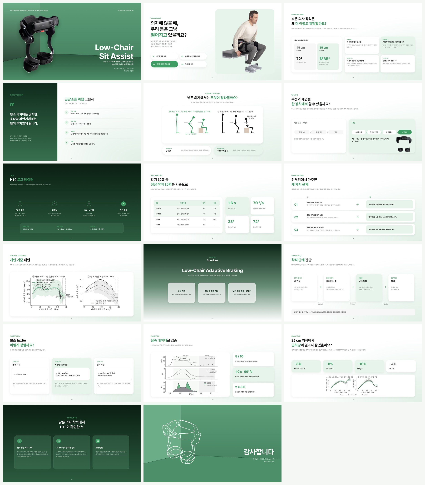
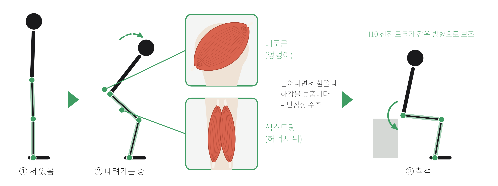
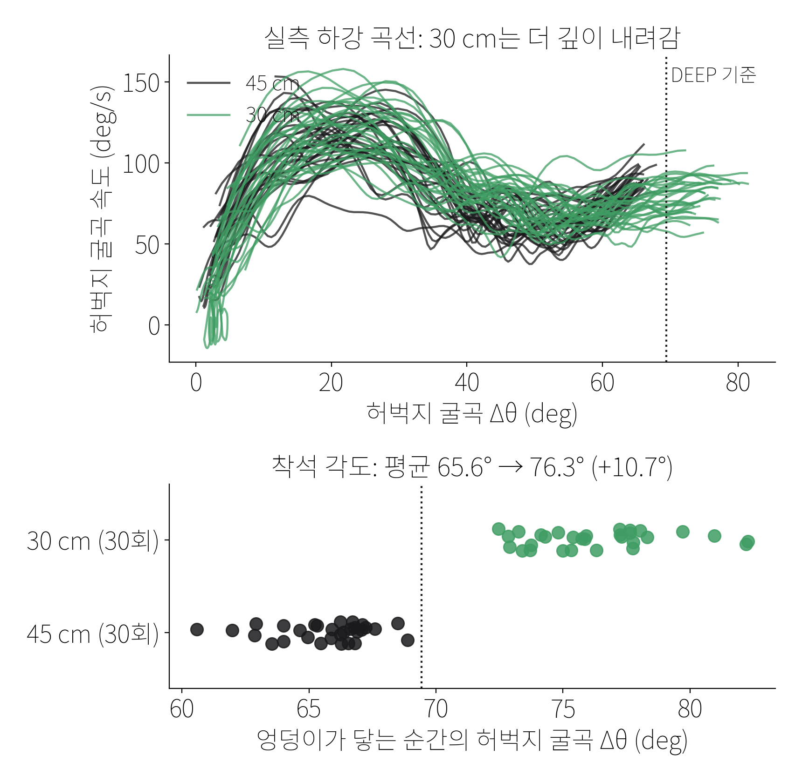

# Low-Chair Sit Assist — 낮은 의자 착석을 위한 엔젤로보틱스 웨어러블 로봇 H10 적응형 하강 제동 알고리즘

> 대상 장비: 엔젤로보틱스(Angel Robotics) 고관절 보조 웨어러블 로봇 **H10** (고관절 엔코더 · 허벅지 IMU · 허리 IMU)

팀 KWAI (이지우, 이지섭, 박수민) · 지도교수 고찬영 · 2026 광운대학교 매치업 심화과정 - 인체데이터분석 및 실습

> 이 프로젝트는 근감소증 일반이 아니라, **낮은 의자에 앉는 순간의 급하강**을 다루는 알고리즘입니다.
> H10이 평소 착석 패턴을 개인 기준으로 학습하고, 평소보다 깊이 내려가는(낮은 의자) 순간과 평소보다 빨라지는 순간에 고관절 신전 토크로 하강을 늦춥니다.

- 발표 슬라이드 (Figma): https://www.figma.com/slides/4tZDoTD6FXxpx83Z0kraKR
- 포스터: Figma 'H10 착석 보조 포스터' (v2)
- **H10에 넣을 코드: [`firmware/`](firmware/)** (C, 1 kHz 제어 루프용). 2차 실측에 실제로 쓴 빌드는 [`firmware/device_2nd_test/`](firmware/device_2nd_test/)
- 발표 대본 · 예상 질문: [`presentation/발표_대본.md`](presentation/발표_대본.md), [`presentation/예상_질문.md`](presentation/예상_질문.md)

## 한눈에: 어떤 지표를 어떻게 재서, 무엇을 알았고, 알고리즘에 어떻게 넣었나

낮은 의자라고 무조건 제동하지 않고, **위험할 때 더 제동**하려고 CoM과 하강 속도를 위험 지표로 봤습니다. H10은 CoM을 못 재서, 실험할 때만 카메라로 CoM을 재고 이를 따라가는 H10 신호를 찾았습니다.

| 지표 | 어떻게 쟀나 | 알게 된 것 | 알고리즘 반영 |
|---|---|---|---|
| CoM (정답지) | 카메라 관절 × 분절 무게 비율(Winter 2009) | 털썩 주저앉으면 CoM이 발 뒤로 약 3.6배 더 빠짐 | H10 신호를 고르는 기준 (실시간에는 안 씀) |
| 엉덩이 하강 속도 | 카메라 엉덩이 높이 변화 ÷ 시간 | 털썩 주저앉기는 빠르게 내려가는 중에 닿음 | 보조 효과 평가 지표 |
| 허벅지 각도 | H10 허벅지 IMU | 낮은 의자에서 10.7° 더 깊음 (65.6° → 76.3°) | 69.4°를 넘으면 낮은 의자(DEEP) |
| 허벅지 속도 | H10 허벅지 IMU 각속도 | CoM을 따라감 (60회 ρ −0.60) | 속도 점수 `z` |
| 상체 숙임 | H10 엔코더 − 허벅지 IMU | CoM을 따라감 (ρ 0.45, 첫 번째 피험자 0.72), 털썩 주저앉기를 착석 약 1초 전 판정 (11/11) | 자세 판정 · 제동을 미리 시작 |
| 착석 충격 | H10 허벅지 IMU 가속도 | CoM을 따라감 (ρ −0.61), 단 닿은 뒤 값 | 착석 판정에만 사용 |
| H10 추정 CoM | H10 각도 + 정강이 17° 가정 | 카메라 CoM과 r 0.74, 털썩 깊이를 놓침 | 실시간에는 안 씀 (정강이 IMU 필요) |

**2차 실측 결과 (보조 OFF → ON 9 Nm, 닿기 직전 하강 속도, 옆 영상):**

| 의자 | OFF | ON | 변화 | p (Mann–Whitney) |
|---|---|---|---|---|
| 45 cm (OFF 30 · ON 31회) | 0.71 m/s | 0.53 m/s | −25% | < 0.001 |
| 30 cm (OFF 20 · ON 20회) | 0.61 m/s | 0.36 m/s | −40% | < 0.001 |

2차 실측은 평소 착석으로만 했습니다. 털썩 주저앉기에서의 효과는 아직 확인하지 않았습니다.



## 왜 낮은 의자인가

같은 사람이 45 cm 의자와 30 cm 의자에 각각 30회 앉은 H10 실측(11월 4일)에서, **30 cm 의자는 허벅지가 평균 10.7° 더 굽혀진 뒤에야 의자에 닿았습니다**(65.6° → 76.3°). 엉덩이가 닿는 순간은 허벅지 IMU 가속도의 충격으로 찾았습니다.

| | 내용 |
|---|---|
| 더 깊이 굽혀야 합니다 | 실측에서 30 cm 의자는 45 cm보다 허벅지가 약 11° 더 굽혀졌습니다. |
| 더 오래, 더 숙여서 버텨야 합니다 | 의자가 낮을수록 동작 시간이 길어지고(40 cm 1.6초 → 30 cm 2.0초) 상체를 더 숙여야 합니다(34.6° → 약 39°)[^yoshioka]. |
| 마지막 순간이 가장 빠릅니다 | 제동이 풀리면 착석 직전에 속도가 붙어 의자에 세게 부딪히거나 뒤로 넘어지기 쉽습니다. |
| 생활 곳곳에 있습니다 | 소파, 좌변기, 좌식 의자처럼 매일 앉는 자리가 낮습니다. |
| 손으로 짚으면 되지 않나요? | 팔로 버티는 것은 하지 기능 저하를 가리는 보상 전략입니다[^vanderkruk]. 지팡이·짐을 든 상황이나 팔걸이 없는 소파·좌변기에서는 쓸 수 없습니다. |
| 하지 보조로 팔 부담이 줄까요? | 선행 연구에서 하지의 착석 제어를 보조하자 팔 지지 힘이 약 70% 줄고 의자 충격이 약 절반으로 줄었습니다[^chang]. 척수손상 2명, 무릎 장치 결과라서 H10 효과로 바로 옮길 수는 없습니다. H10 OFF/ON 비교로 같은 방향의 변화가 나타나는지 확인합니다. |

### 낮은 의자와 CoM은 어떻게 이어지나

1. **더 깊이 내려갑니다.** 30 cm 의자는 허벅지가 10.7° 더 굽혀진 뒤에야 닿습니다(실측). 엉덩이가 발에서 더 멀리, 더 아래로 갑니다.
2. **더 숙여야 버팁니다.** CoM을 발 위에 두려면 상체를 더 숙여야 합니다(40 → 30 cm, 34.6° → 약 39°)[^yoshioka].
3. **못 숙이면 뒤로 털썩.** CoM이 발 뒤로 빠지면 마지막에 빨라지며 뒤로 주저앉습니다.

H10은 CoM을 직접 재지 못합니다. 그래서 **낮은 의자 판정은 CoM이 아니라 허벅지 각도로** 하고, CoM은 무너지는 방향을 보는 대용 지표로만 씁니다.

| H10 신호 | 대신 보는 것 | 알고리즘에서 | 실측 (45 → 30 cm) |
|---|---|---|---|
| 허벅지 각도 Δθ | 얼마나 깊이 내려갔나 | 69.4°를 넘으면 DEEP(낮은 의자), 제동 1.5배 | 66° → 76°, 판정 30/30 |
| 상체 숙임 φ (엔코더 − 허벅지 IMU) | CoM 앞뒤 위치 | 평소보다 덜 숙이면 제동 1.5배 | 11.1° → 10.7° (늘지 않음) |
| 후반 하강 속도 ω | CoM 낙하 속도 | 평소보다 훨씬 빠르면(z > 3.5) 제동 | 접촉 속도 95 → 74 °/s |

30 cm에서 더 깊이 앉았는데 상체 숙임은 늘지 않았습니다. 선행 연구만큼 더 숙이지 않았으니 CoM이 상대적으로 뒤에 남는 쪽이라고 추정합니다(CoM 자체는 측정하지 않았습니다).

**CoM 검증 계획 (카메라, 측정 예정, 코드: `video_com.py`):** H10만으로는 정강이·발 위치를 몰라 CoM이 발 뒤로 빠졌는지 직접 알 수 없습니다. 그래서 실험실에서만 옆에서 영상을 찍고, 포즈 추정으로 관절 좌표를 얻은 뒤 분절 질량비(Winter 2009)로 CoM을 계산합니다. 엉덩이가 닿는 프레임과 H10 IMU 충격으로 시간을 맞추고, CoM–발목 앞뒤 거리가 H10의 상체 숙임·후반 속도와 같이 움직이는지 확인합니다. 카메라는 정답을 만드는 데만 쓰고, 실제 제어는 H10 센서만으로 합니다.

그래서 알고리즘에는 **DEEP 단계(평소 착석 각도 + 2SD를 넘어 계속 내려감 → 낮은 의자로 판단, 제동 1.5배)** 가 있습니다.

## 1. 타깃 사용자

| 항목 | 내용 |
|---|---|
| 대상 | **착석 제어가 어려운 근감소증 위험 고령자.** 근거: AWGS 2019 기준 5회 의자 일어서기 ≥ 12초[^awgs] |
| 신체 특성 | 독립 보행 가능 · 하지 근력 저하 |
| 문제 상황 | 낮은 소파 · 좌변기 · 낮은 의자 |
| 착석 특성 | 착석 후반부에서 하강 속도를 제어하지 못하고 털썩 앉음 |
| 왜 문제인가 | 앉기·일어서기 같은 자세 전환은 고령자 낙상이 자주 일어나는 순간[^robinovitch]. 지역사회 고령자는 앉을 때 젊은 성인보다 상체를 약 10° 덜 숙이고[^dubost], 낙상 고위험 고령자 낙상의 17.6%가 뒤로 주저앉는 방향입니다[^stevens]. |
| 규모 | 한국 70~84세 근감소증 유병률 남 26.8%·여 18.8%[^kim2025], 65세 이상 낙상 경험률 7.2%[^survey2020] |

### 용어



| 용어 | 뜻 |
|---|---|
| 굴곡 · 신전 | 굴곡은 관절을 굽히는 움직임, 신전은 펴는 움직임입니다. 앉을 때 고관절은 굴곡합니다. |
| 고관절 신전근 | 엉덩이의 대둔근과 허벅지 뒤의 햄스트링입니다. 다리를 뒤로 펴는 힘을 냅니다. |
| 편심성 수축 | 근육이 늘어나면서 힘을 내는 수축입니다. 앉을 때 하강 속도를 늦추는 브레이크가 됩니다. 부드럽게 앉을수록 고관절 근육의 기여가 커집니다[^jeon]. |
| 근감소증 | 나이가 들며 근육량과 근력이 함께 줄어드는 질환입니다.[^awgs] |
| IMU | 가속도와 회전 속도로 기울기와 움직임을 재는 관성 센서입니다. |
| CoM | 몸 전체의 무게중심(골반 앞쪽 부근)입니다. 발 위에 있으면 균형이 유지되고, 뒤로 빠지면 털썩 주저앉습니다. H10은 CoM을 직접 재지 못해 상체 숙임과 착석 후반 하강 속도로 대신 봅니다. |
| 엔코더 (incPosDeg) | 고관절 모터의 회전 센서로 잰 각도입니다. 허벅지 IMU 각도를 빼면 상체 기울기가 됩니다. |
| Δθ | 서 있을 때보다 허벅지가 굽혀진 각도입니다. |
| ω (각속도) | 허벅지가 굽혀지는 속도(°/s)입니다. |
| σ · SD (표준편차) | 여러 번 착석 사이에 값이 흩어진 정도입니다. 2SD 안에 정상 착석의 약 95%가 들어옵니다. |
| z | 지금 속도가 평소 평균보다 표준편차의 몇 배만큼 빠른지 나타냅니다. |
| τ (토크), Nm | 관절을 돌리는 힘과 그 단위(뉴턴미터)입니다. |
| RMS jerk | 가속도가 얼마나 급하게 바뀌는지의 평균 크기입니다. 작을수록 부드럽습니다.[^jerk] |
| leave-one-out | 한 번씩 빼고 나머지로 기준을 만든 뒤, 빼 둔 시행으로 시험하는 교차 검증입니다. |

## 2. 실측 데이터

| 파일 (11월 4일) | 조건 | 검출한 앉기 | 사용 | 비고 |
|---|---|---|---|---|
| `11.4_45cm_10times_{1,2,3}` | 45 cm | 30회 | 30회 | 개인 기준(하강 속도 · 평소 착석 각도) |
| `11.4_30cm_10times_1`, `11.4_30cm_12times_{2,3}` | 30 cm | 30회 | 30회 | 1·2번 파일은 앉은 채로 녹화가 시작돼 첫 앉기는 없음 |
| `11.4_45cm_assist_10times_{1,2,3}` | 팔걸이 짚고 앉기 | 31회 | – | 높이·횟수 확인 중이라 분석에서 뺌 |

10월에 받은 예비 기록(SUIT-4/5: 45 cm 2회, SUIT-22/33: 30 cm 10회)은 `data/real/1010_*`에 두고 비교용으로만 씁니다.

```bash
pip install -r requirements.txt
python preprocess_h10.py ~/Downloads/11.4_45cm_10times_{1,2,3}.csv --out data/real/chair45
python preprocess_h10.py ~/Downloads/11.4_30cm_10times_1.csv ~/Downloads/11.4_30cm_12times_{2,3}.csv --out data/real/chair30
python compare_chairs.py --out results/real            # 45 cm vs 30 cm 비교, 오작동 · 민감도 · DEEP 판정
python firmware/export_params.py                      # 기준값 → firmware/sit_assist_params.h
python poster/make_figures.py --palette slides --out presentation/figs
python -m pytest -q . firmware                        # 알고리즘 + C/Python 동일성 테스트
```

H10 앱에서 내보낸 CSV(첫 줄이 `loopCnt,...`)와 hex 원시 로그(`SUIT_LOGGED_DATA-*.csv`)를 모두 읽습니다.

> ⚠️ **인체 실험 데이터 보호:** `data/`와 `results/`는 `.gitignore`에 들어 있어 커밋되지 않습니다.

### 신호와 전처리

| 알고리즘 입력 | H10 필드 | 설명 |
|---|---|---|
| `thigh_l_deg`, `thigh_r_deg` | `thighDeg_LH`, `thighDeg_RH` | IMU 허벅지 절대 각도 |
| `trunk_deg` | 좌우 평균 `incPosDeg − thighDeg` | 고관절 엔코더 각 − 허벅지 각 = 골반·상체 기울기 |
| 보조 여부 확인 | `u_LH`, `u_RH` | 보조 토크가 켜져 있던 앉기 표시 |

- 로그는 1 kHz이고 10샘플 평균으로 100 Hz로 바꿉니다. 디코딩 결과는 수업 디코더와 반올림 오차(0.0005) 수준에서 일치합니다.
- 일어선 뒤 바로 다시 앉아 서 있는 시간이 짧아서, 앉기 구간은 **직전에 가장 똑바로 선 순간**부터 자릅니다.
- 앉은 뒤에도 몸이 흔들려 착석 판정을 `|ω| < 8°/s, 0.15 s`로 완화했습니다.
- 좌우 허벅지 각도가 10° 가까이 차이 나서 기준 조회는 좌우 평균 Δθ로 합니다.

## 3. 실측 결과

| 지표 | 45 cm (30회) | 30 cm (30회) | 차이 |
|---|---|---|---|
| 착석 각도 Δθ (°) | 65.6 ± 1.9 | 76.3 ± 2.7 | **+10.7** |
| 최대 허벅지 굴곡 속도 (°/s) | 123 ± 12 | 126 ± 16 | +2 |
| 착석 순간 속도 (°/s) | 95.2 ± 10.4 | 73.6 ± 6.8 | −21.6 |
| 착석 시간 (s) | 1.0 ± 0.1 | 1.1 ± 0.1 | +0.1 |
| 최대 상체 숙임 (°) | 11.1 ± 4.0 | 10.7 ± 4.0 | −0.4 |
| 낮은 의자(DEEP) 판정 | 0 / 30 | **30 / 30** | |

착석 순간은 허벅지 IMU 가속도(1 Hz 고역 통과)가 3 m/s²를 넘는 충격으로 정했습니다. 60회 모두 검출됐고, 닿기 전 구간의 최댓값은 2.84 m/s²였습니다. 각도만으로 '멈춤'을 찾던 이전 방식보다 약 0.4초 빠르고, 그래서 착석 각도와 착석 순간 속도가 이전 표(85.1° / 15 °/s)와 다릅니다.



- **낮은 의자 판정:** 45 cm 착석 각도로 정한 DEEP 기준(69.4°)으로 30 cm 착석 30회를 모두 낮은 의자로 판정했고, 45 cm는 한 번도 잘못 판정하지 않았습니다(0/30).
- **정상 착석 오작동:** 45 cm 착석 30회를 하나씩 빼고 기준을 만들어 재생했을 때 29회는 제동이 켜지지 않았습니다.
- **민감도:** 같은 착석의 후반(끝 각도의 절반 이후)만 2배 빠르게 만든 가상 착석에서는 30회 중 17회 제동했습니다. 1.5배에서는 2회뿐입니다. 이전에 보고한 24/30은 대부분 엉덩이가 닿은 뒤의 제동이었고, IMU 충격으로 착석 순간을 정확히 잡자 줄었습니다. 오작동을 줄이는 쪽(min_sd 25, 제동 시작 50%)을 유지했습니다. 실제로 털썩 앉은 기록이 없어서 가상 시행으로 확인했습니다.
- 피험자가 건강한 성인이라 30 cm에서도 속도를 잘 제어했습니다(착석 순간 속도는 오히려 느림). 의자 높이 차이는 착석 각도에서 가장 크게 드러났습니다.
- **제동 효과(속도·jerk 감소)는 아직 실측하지 않았습니다.** 아래 4장의 코드를 H10에 넣고 30 cm 의자에서 OFF / ON을 비교해 확정합니다.

### 11월 4일 데이터로 바꾼 설계

10월 기준(30 cm 10회)으로 만든 설정을 45 cm 30회에 그대로 쓰면 정상 착석 30회 중 25회에 제동이 걸렸습니다. 속도 곡선에 봉우리가 두 개 있고 그 시점이 매번 조금씩 밀리는데, 각도별 표준편차가 10°/s 정도로 작아서 평범한 차이도 "평소보다 6~13배 빠름"으로 계산됐기 때문입니다. 두 가지를 바꿨습니다.

| 설정 | 전 | 후 | 이유 |
|---|---|---|---|
| 허용 폭 하한 `min_sd` | 5°/s | **25°/s** | 정상 착석 30회도 같은 각도에서 이만큼은 흔들림 |
| 제동 시작 `brake_from_ratio` | 평소 착석 각도의 25% | **50%** | 털썩은 착석 직전에 일어나고, 초반은 사람마다 차이가 큼 |

| 결과 (45 cm 기준) | 전 | 후 |
|---|---|---|
| 정상 착석에서 제동 | 25 / 30 | **1 / 30** |
| 후반 1.5배 빠른 가상 착석 감지 | 30 / 30 | 2 / 30 (2배: 17 / 30) |
| 30 cm 낮은 의자 판정 | 25 / 30 | 30 / 30 (IMU 착석 판정 적용 후) |

### 부록: 팔걸이 짚고 앉기

팔걸이를 짚고 앉은 기록 31회를 45 cm 정상 착석과 비교했습니다(의자 높이는 확인 중이라 본 분석에서는 빼고 부록으로 둡니다).

| 지표 | 45 cm 정상 | 팔걸이 |
|---|---|---|
| 착석 순간 속도 (°/s) | 95.2 | 11.7 |
| 최대 상체 숙임 (°) | 11.1 | 5.0 |
| 하강 시간 (s) | 1.0 | 1.9 |

팔로 버티면 착석 직전 속도가 거의 0이 되고 상체를 덜 숙입니다. 하지가 하던 제동을 팔이 대신한다는 뜻이고, H10이 대신 맡으려는 부분이 바로 이 제동입니다.

### H10 보조 ON 1차 실측

알고리즘을 H10에 넣고 강도를 최대로 올려 확인한 문제입니다.

1. **후반 급하강 제어 부족:** 착석 초반은 느려지지만 엉덩이가 닿기 직전 다시 빨라졌습니다.
2. **앉기 전 선행 작동:** 앉기 시작 전부터 보조가 켜져 동작이 머뭇거렸습니다.
3. **서 있을 때 오작동:** 가만히 서 있거나 고개만 돌려도 보조가 작동했습니다.

### 2차 보조 알고리즘과 2차 실측

1차 문제를 고쳐 2차 실측에 쓴 장비용 코드는 [`firmware/device_2nd_test/`](firmware/device_2nd_test/)입니다(`sit_assist.c`의 `SA_BRAKE_*`, `SA_EARLY_BRAKE`).

| 1차 문제 · 실험 결과 | 2차 코드 |
|---|---|
| 털썩 주저앉기는 착석 약 1초 전에 보이지만, 속도 제동은 닿기 전 0/11 | 제동 구간이 열리면 속도 점수를 기다리지 않고 바로 9 Nm (`SA_EARLY_BRAKE`) |
| 앉기 전 보조 · 서 있을 때 오작동 | 허벅지 25° 이상(`SA_BRAKE_START_DEPTH`) + 두 다리 10°/s 넘게 내려갈 때만(`SA_BRAKE_MIN_VEL`) |
| 착석 근처에서 제동이 여러 번 다시 걸림 | 70°(`SA_BRAKE_STOP_DEPTH`) · 착석 · 60 ms 멈춤이면 끝, 한 번 내려갈 때 한 번, 구간 밖 토크 0 |
| 9 Nm까지 안전하게 | 상한 9 Nm(`SA_TAU_LIMIT`, 모터 5.7 A), 오를 때 60 · 풀 때 108 Nm/s, 모드 · 연결 · 센서 이상이면 0 |

장비용 SDK 연결 코드(`algorithm_ctrl.c/h`)는 수업 SDK 코드가 섞여 있어 저장소에 올리지 않았습니다. 관절 토크(Nm)를 모터 전류로 바꿀 때 기어비 18.75 × 토크 상수 0.085 Nm/A를 씁니다.

보조를 켜자 닿기 직전 하강 속도가 45 cm에서 25%, 30 cm에서 40% 줄었습니다(위 표). 같은 9 Nm 제동에서 낮은 의자의 감소 폭이 더 큰 이유는 추가로 확인해야 합니다.

저장소의 [`firmware/`](firmware/)(Python과 같은 계산, 동일성 테스트 포함)에는 '상체 덜 숙임 판정 즉시 1.5 Nm' 버전이 있습니다. 실측 로그 재생에서 털썩 주저앉기의 닿기 전 제동이 0/11 → 11/11(착석 1.0초 전, 중앙값)이었습니다. 실험 순서는 [`firmware/2차_실측_체크리스트.md`](firmware/2차_실측_체크리스트.md)에 있습니다.

## 4. H10에 넣기 (`firmware/`)

| 파일 | 내용 |
|---|---|
| `sit_assist.h`, `sit_assist.c` | 알고리즘 본체. 동적 메모리 없음, 상태는 구조체 하나 |
| `sit_assist_params.h` | 실측 기준값(하강 속도 표, DEEP 기준 69.4° 등). `export_params.py`가 만듦 |
| `export_params.py` | `results/real/profile_45ref.json` → 헤더 |
| `test_firmware.py` | 실측 착석 60회와 끊기지 않은 로그에서 C와 Python 토크가 같은지 확인 (double 1e-6 Nm, float 0.05 Nm 이내) |
| `2차_실측_체크리스트.md` | 2차 실측 당일 순서: 그림자 모드 디버그 → 기준값 → 방향 · 상한 → 본 실험 → 분석 |

```c
#include "sit_assist.h"
static SA_State sa;

void controller_init(void) { sa_init(&sa); }

void controller_1khz(void)              /* H10 제어 루프 */
{
    float tau[2];                        /* 왼쪽·오른쪽 신전 토크 (Nm) */
    sa_step_1khz(&sa, thighDeg_LH, thighDeg_RH, incPosDeg_LH, incPosDeg_RH,
                 accX_Calib_LH, accY_Calib_LH, accX_Calib_RH, accY_Calib_RH, tau);
    u_LH = SA_EXT_SIGN_L * SA_TORQUE_TO_U * tau[0];
    u_RH = SA_EXT_SIGN_R * SA_TORQUE_TO_U * tau[1];
    free_var1 = sa_log_state(&sa);      /* 단계*10 + 제동 단계 + 5(상체 덜 숙임). 단계: 0 서 있음, 1 내려감, 2 DEEP, 3 착석 */
    free_var2 = sa_log_torque(&sa);     /* 계산한 토크 (Nm) */
}
```

**반드시 확인할 설정** (`sit_assist.h` 맨 위, 컴파일 옵션 `-D`로 바꿀 수 있음)
- `SA_TORQUE_TO_U`: Nm를 `u_RH/u_LH` 제어 입력으로 바꾸는 계수입니다. 수업 SDK의 단위를 확인해 넣으세요.
- `SA_EXT_SIGN_L/R`: 신전 방향 부호입니다. 첫 착용 때 가장 낮은 토크로 방향부터 확인하세요.
- `SA_TAU_LIMIT`: 안전 상한입니다. 기본 2 Nm에서 시작해 단계적으로 올리세요.
- `SA_SHADOW=1`: 계산과 로그만 하고 토크는 0입니다. **OFF 조건**은 이 설정으로 같은 코드를 돌리면 판정 기록까지 같은 형식으로 남습니다.
- 보조자가 옆에 서 있고, 긴급 정지 버튼이 손에 닿는 상태에서 진행하세요.

### OFF / ON 비교

```bash
python compare_h10_runs.py --off <OFF 로그들> --on <ON 로그들> --out results/h10_onoff
```

원본 hex 로그와 디코딩된 CSV를 모두 받습니다. 앉기를 자동으로 찾아 최대 허벅지 굴곡 속도, 착석 순간 속도, 최대 각가속도, RMS jerk, 착석 시간, 최대 상체 숙임을 OFF와 ON으로 나눠 표로 만듭니다. `free_var1/2`가 기록돼 있으면 DEEP 판정과 토크도 함께 봅니다.

### 카메라 CoM 검증 (`video_com.py`)

H10의 상체 숙임 · 착석 속도가 실제 CoM을 따라가는지, 옆에서 찍은 영상으로 확인합니다. 카메라는 검증용이고 제어에는 쓰지 않습니다.

**촬영**
- 의자 옆, 몸과 수직 방향에서 찍습니다. 머리부터 발끝(발뒤꿈치 · 발끝 포함)까지 계속 화면에 들어와야 합니다.
- 30 fps 이상, 카메라는 삼각대로 고정하고 허리 높이에 둡니다. 카메라 쪽 다리가 가려지지 않게 합니다.
- H10을 입고 같은 프로토콜(45 cm · 30 cm 각 10회 × 3세트)로 앉습니다. 영상 한 개 = H10 로그 한 개가 되게 세트마다 따로 찍습니다.
- 다리 길이(대전자 ~ 바깥 복사뼈, cm)를 재 두면 결과를 cm로도 볼 수 있습니다.
- 영상은 사람 데이터라 `data/video/`에 두고 저장소에 올리지 않습니다.

- 폰을 눕혀 찍어도 됩니다(`extract`가 회전을 자동으로 맞춤). 손으로 들고 찍으면 발목 기준으로 높이를 재서 흔들림을 줄이지만, 고정하는 게 가장 좋습니다.

**몸이 잘린 영상**

머리 · 어깨 · 발이 화면 밖이면 MediaPipe가 추측 좌표를 내는데, 화면 밖 좌표는 안 보인 것으로 칩니다. 그 뒤 보이는 부분으로 계산할 수 있는 것만 냅니다.

| 보이는 부분 | 모드 | 나오는 값 |
|---|---|---|
| 전부 | `full` | CoM–발목 거리, CoM 하강 속도, 아래 값 전부 |
| 머리 · 손 · 발만 잘림 | `estimated` | 위와 같음. 머리는 어깨 위 몸통 길이 25%로, 발은 발목으로 근사 |
| 어깨 · 팔이 잘림 | `partial` | 엉덩이–발목 거리, 허벅지 각도, 엉덩이 하강 속도 (CoM 아님) |
| 발이 잘림 | `partial` | 카메라 상체 숙임, 허벅지 각도 (길이 기준은 허벅지 × 2) |
| 무릎 아래가 다 잘림 | `partial` | 카메라 상체 숙임, 엉덩이 하강 (길이 기준은 엉덩이–어깨 × 1.8) |

몸통 · 팔 · 다리처럼 무거운 분절은 근사하지 않습니다. 하나라도 없으면 CoM은 계산하지 않습니다. 발 길이가 화면에서 너무 짧으면(옆이 아니라 앞/뒤에서 찍은 경우) 경고를 냅니다.

**설치와 실행**

```bash
pip install mediapipe opencv-python
python video_com.py extract data/video/45cm_1.mp4 --out data/video/pose/45cm_1_pose.csv
python video_com.py overlay data/video/45cm_1.mp4 data/video/pose/45cm_1_pose.csv
python video_com.py analyze data/video/pose/45cm_1_pose.csv ~/Downloads/11.4_45cm_10times_1.csv --chair "45 cm" --leg-cm 90
python video_com.py match --pose data/video/pose/*_pose.csv --h10 ~/Downloads/11.4_*.csv
python video_com.py summary results/video
```

- `extract`: MediaPipe로 프레임마다 관절 좌표를 뽑습니다.
  - 최신 mediapipe에는 예전 Pose API가 없어서 Tasks 모델 `data/models/pose_landmarker_heavy.task`를 씁니다. 받는 곳은 [MediaPipe Pose Landmarker](https://developers.google.com/mediapipe/solutions/vision/pose_landmarker)이고, 다른 경로에 있으면 `--model`로 지정합니다.
  - `--rotate`의 기본값은 `auto`입니다.
  - 다른 포즈 도구의 좌표도 같은 열 이름(`hip_r_x` 등)의 CSV로 넣을 수 있습니다.
- `overlay`: 착석 시작 · 착석 프레임에 관절 선과 CoM(빨간 점), 발목 수직선을 그려 한 장으로 붙입니다. 숫자를 믿기 전에 눈으로 확인하는 용도입니다.
- `analyze`:
  - 카메라 쪽 다리를 골라 Winter(2009) 분절 질량비로 CoM을 계산합니다.
  - CoM–발목 앞뒤 거리를 구합니다. 다리 길이로 나눈 값이고, 바라보는 방향이 +입니다.
  - 착석은 허벅지 각도로 찾습니다. 25° 아래에서 55° 위로 넘어간 뒤 굽힘이 멈춘 순간이 착석이고, H10과 같은 기준이라 카메라 흔들림에 강합니다.
  - H10 로그를 주면 착석 충격과 맞춰 시간 차이를 자동으로 찾습니다. 안 맞으면 `--offset`으로 직접 줍니다.
  - H10 로그 없이 영상 지표만 볼 수도 있습니다.
- `match`: 어느 영상이 어느 H10 로그인지 모를 때 씁니다.
  - 영상 허벅지 각도 곡선과 H10 허벅지 각도 곡선을 통째로 겹쳐 보고, 가장 잘 맞는 시간차와 상관계수 r을 찾습니다. 다리가 잘린 영상이면 상체 각도 곡선을 씁니다.
  - 같은 세션이면 r이 0.9 안팎으로 나오고 2등과 차이가 크게 나야 합니다. r이 0.6 아래면 같은 세션이 아니라고 봅니다.
  - 착석 시각만 맞추는 방식도 같이 보여줍니다. 다만 착석 간격이 규칙적인 실험끼리는 우연히 겹치기 쉬워서 보조 지표로만 씁니다.
- `summary`: 앉기별 카메라 지표와 H10 신호를 비교해 의자별 Pearson · Spearman 상관과 그래프를 `results/video/`에 저장합니다.
  - 비교하는 H10 신호는 최대 상체 숙임, 착석 각도, 착석 속도, 후반 하강 속도입니다.
  - 특히 카메라 상체 숙임과 H10 상체 숙임은 같은 것을 잰 값이라 센서 검증이 됩니다.

## 5. 알고리즘

**FSM**

| 상태 | 들어가는 조건 | 하는 일 |
|---|---|---|
| STANDING | 시작 / 착석 후 Δθ < 10° / 얕을 때 다시 일어섬 | 토크 0, 기준 자세 갱신 |
| DESCENT | 양쪽 허벅지 ω > 5°/s, 0.1 s 유지 | 개인 기준 대비 제동 |
| DEEP | Δθ > 평소 착석 각도 + 2SD (실측 69.4°), 아직 착석 전 | 평소 착석 순간 속도까지 감속, 제동 gain ×1.5 |
| SEATED | 압력센서 ON, 허벅지 IMU 충격 > 3 m/s², `|ω| < 8°/s` 0.15 s, 또는 깊이 내려간 뒤 펴지기 시작 | 0.3초에 걸쳐 토크 해제 |

**토크**
- 상체 지지(`τ_s = K_s × sin φ`)는 실측 후 쓰지 않기로 해서 `support_gain = 0`입니다.
- 적응형 제동: `z = (ω̂ − ω_ref(θ̂)) / σ(θ̂)`, `τ_b = 2.5 Nm × g × max(0, z − 3.5)`
  - 0.05초 뒤의 속도와 각도를 예측해서 미리 반응합니다.
  - DEEP이거나 상체를 평소보다 덜 숙였으면 `g = 1.5`입니다. 급가속이면 `z ≥ 5`로 처리합니다.
- 출력: `τ = clip(τ_s + τ_b, 0, 10 Nm)`, 상승 속도 ≤ 60 Nm/s, 일어설 때는 0. 펌웨어에서는 `SA_TAU_LIMIT`로 한 번 더 제한합니다.

**멈칫 착석:** 압력센서나 IMU 충격 없이 속도로만 착석(SEATED)이라고 본 뒤, 양쪽 허벅지가 다시 15°/s보다 빠르게 굽혀지면 하강으로 되돌립니다(`resume_vel`). 11/7 털썩 11회 중 4회가 반쯤 멈췄다가 떨어졌는데, 이전에는 멈춘 순간을 착석으로 봐서 마지막에 떨어지는 구간을 놓쳤습니다.

**CoM 제동 (시험용, 기본 꺼짐):** `com_gain > 0`이면 켜집니다. 펌웨어에는 아직 없습니다.
- H10 허벅지 · 상체 각도로 외삽 CoM을 추정합니다(`h10_com_dx`, 정강이는 15°로 가정). 평소 대비 얼마나 뒤인지를 점수(`z_com`)로 냅니다.
- 속도 점수와 CoM 점수의 합이 5를 넘으면 제동합니다.
- 11/7 오프라인 재생 결과: 털썩 55%(이전 0%), 평소 착석 0%, 11/4 45 cm 7%에서 제동했습니다.
- 다만 제동이 착석 직전 0.03초 정도만 걸려서 토크가 2 Nm 남짓입니다. 실제로 막으려면 더 일찍 반응해야 합니다.

**기준값:** 하강 속도 표와 평소 착석 각도(DEEP 기준)는 모두 45 cm 착석 30회로 만들었습니다. 표준편차는 25°/s보다 작게 잡지 않고, 제동은 평소 착석 각도의 절반을 지난 뒤부터 겁니다.

## 6. 주장할 수 있는 범위

- ✅ "낮은 의자에서는 착석 각도가 더 깊어지고(실측 +10.7°, 30회씩), H10 알고리즘이 이를 낮은 의자로 판정한다(30/30, 45 cm 오판정 0/30)"
- ✅ "H10 보조(9 Nm)를 켜면 닿기 직전 하강 속도가 줄었다 (45 cm −25%, 30 cm −40%, 평소 착석)"
- ✅ "H10 상체 숙임은 카메라 CoM을 따라가고, 털썩 주저앉기를 착석 약 1초 전에 알아챘다 (같은 사람, 기록 재생)"
- ⏳ 털썩 주저앉기에서의 실제 제동 효과는 아직 실측하지 않았습니다.
- ❌ 낙상 예방, 근력 회복, 재활 효과. 짧은 실험과 건강한 성인 실험으로는 입증할 수 없습니다.

## 7. 파일

| 파일 | 내용 |
|---|---|
| `h10_decode.py` | H10 SUIT hex 로그 디코더 |
| `preprocess_h10.py` | 1 kHz → 100 Hz, 앉기 자동 검출 |
| `compare_chairs.py` | 실측 45 cm vs 30 cm 비교, DEEP 판정 검증 |
| `sit_assist.py` | 신호 처리, FSM, 개인 기준(Profile), 실시간 컨트롤러 (Python 기준 구현) |
| `firmware/` | H10용 C 구현, 기준값 헤더, 동일성 테스트 |
| `firmware/device_2nd_test/` | 2차 실측에 쓴 장비용 빌드 (제동 구간 25°~70°, 조기 제동 9 Nm) |
| `pool_com_h10.py` | 카메라 + H10 세 세트(60회) 통합 분석 |
| `compare_h10_runs.py` | H10 OFF / ON 로그 비교 |
| `calibrate.py` | 착석 기록 → `profile.json` + 정상 착석 오작동 확인 |
| `video_com.py` | 옆 영상 → CoM 계산, H10 신호와 비교 (검증용) |
| `evaluate.py` | 지표 계산 (최대 속도, jerk, 착석 순간 속도 등) |
| `simulate_data.py` | (참고) 근력 저하 사용자 모델 시뮬레이션. 발표 결과에는 쓰지 않음 |
| `poster/`, `presentation/` | 포스터·발표 자료와 그림 생성 스크립트 |
| `docs/slides/` | Figma 발표 슬라이드 캡처 |

## 참고문헌

[^robinovitch]: Robinovitch SN, Feldman F, Yang Y, et al. Video capture of the circumstances of falls in elderly people residing in long-term care: an observational study. *Lancet*. 2013;381(9860):47–54.
[^awgs]: Chen LK, Woo J, Assantachai P, et al. Asian Working Group for Sarcopenia: 2019 Consensus Update on Sarcopenia Diagnosis and Treatment. *J Am Med Dir Assoc*. 2020;21(3):300–307.e2.
[^yoshioka]: Yoshioka S, Nagano A, Hay DC, Fukashiro S. Peak hip and knee joint moments during a sit-to-stand movement are invariant to the change of seat height within the range of low to normal seat height. *BioMed Eng OnLine*. 2014;13:27. (젊은 성인 8명, 일어서기 동작)
[^dubost]: Dubost V, Beauchet O, Manckoundia P, et al. Decreased trunk angular displacement during sitting down: an early feature of aging. *Phys Ther*. 2005;85(5):404–412.
[^stevens]: Stevens JA, Mahoney JE, Ehrenreich H. Circumstances and outcomes of falls among high risk community-dwelling older adults. *Inj Epidemiol*. 2014;1:5.
[^vanderkruk]: van der Kruk E, Silverman AK, Reilly P, Bull AMJ. Compensation due to age-related decline in sit-to-stand and sit-to-walk. *J Biomech*. 2021;122:110411.
[^chang]: Chang SR, Nandor MJ, Kobetic R, Foglyano KM, Quinn RD, Triolo RJ. Improving stand-to-sit maneuver for individuals with spinal cord injury. *J NeuroEng Rehabil*. 2016;13:27.
[^jeon]: Jeon et al. *Front Hum Neurosci*. 2024. 앉기는 일어서기의 역동작이 아니라 하강 중 균형 제어가 필요한 동작이며, 부드럽게 앉을수록 고관절 근육의 기여가 커집니다 (젊은 성인 12명).
[^kim2025]: Kim et al. *Medicina*. 2025;61(6):1065 (Kim & Won 2020 재인용).
[^survey2020]: 보건복지부. 2020 노인실태조사 (언론 보도 재인용).
[^jerk]: Balasubramanian S, Melendez-Calderon A, Roby-Brami A, Burdet E. On the analysis of movement smoothness. *J NeuroEng Rehabil*. 2015;12:112.
