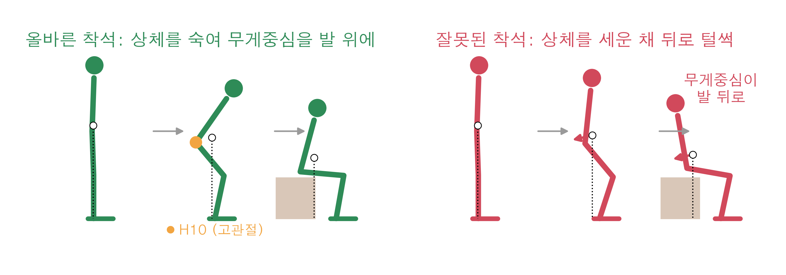
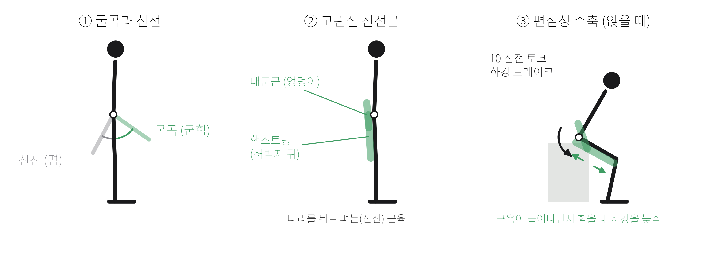
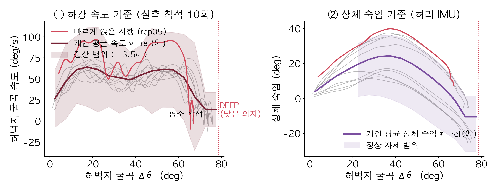
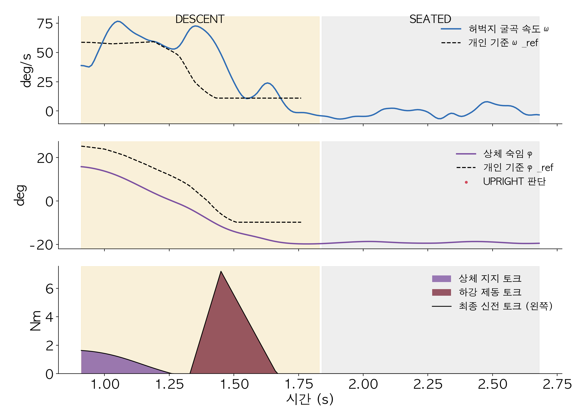
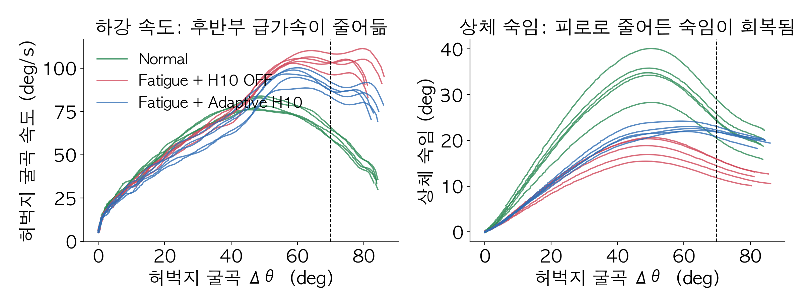

# Low-Chair Sit Assist — 낮은 의자 착석을 위한 H10 적응형 하강 제동 알고리즘

팀 KWAI (이지우, 이지석, 박수민) · 지도교수 고찬영 · 2026 광운대학교 매치업 심화과정 - 인체데이터분석 및 실습

> 이 프로젝트는 근감소증 일반이 아니라, **낮은 의자에 앉는 순간의 급하강**을 다루는 알고리즘입니다.
> H10이 평소 착석 패턴을 개인 기준으로 학습하고, 평소보다 깊이 내려가는(낮은 의자) 순간과 평소보다 빨라지는 순간에 고관절 신전 토크로 하강을 늦춥니다.

- 발표 슬라이드 (Figma): https://www.figma.com/slides/4tZDoTD6FXxpx83Z0kraKR
- 포스터: [`poster/착석보조_포스터.pptx`](poster/착석보조_포스터.pptx) ([미리보기](poster/poster_preview.png))


## 왜 낮은 의자인가

| | 내용 |
|---|---|
| 더 깊이 굽혀야 합니다 | 평소 의자(45 cm)의 착석 각도는 실측 72°입니다. 낮은 의자(35 cm)에서는 허벅지가 10~15° 더 굽혀질 때까지 내려가야 의자에 닿습니다. |
| 가장 약한 자세에서 버텨야 합니다 | 깊게 굽힌 자세일수록 고관절 신전근이 체중을 버티기 어렵습니다. 근력이 약하면 이 구간에서 무너집니다. |
| 마지막 순간이 가장 빠릅니다 | 제동이 풀리면 착석 직전에 속도가 붙어 의자에 세게 부딪히거나 뒤로 넘어지기 쉽습니다. |
| 생활 곳곳에 있습니다 | 소파, 좌변기, 좌식 의자처럼 매일 앉는 자리가 낮습니다. |

낮은 의자일수록 일어설 때 고관절·무릎에 걸리는 부하가 커진다는 연구가 있습니다[^rodosky]. 그래서 알고리즘에는 **DEEP 단계(평소 착석 각도 + 2SD를 넘어 계속 내려감 → 낮은 의자로 판단, 제동 1.5배)** 가 있습니다.

## 1. 타깃 사용자

| 항목 | 내용 |
|---|---|
| 대상 | **착석 제어가 어려운 근감소증 위험 고령자.** 근거: AWGS 2019 기준 5회 의자 일어서기 ≥ 12초[^awgs] |
| 상태 | 혼자 걸을 수 있지만 고관절 신전근의 편심성 제어가 약해 착석 후반부를 버티지 못함 |
| 상황 | 낮은 의자·소파·좌변기에서 털썩 앉음. 상체를 덜 숙여 무게중심이 발 뒤로 빠짐 |
| 왜 문제인가 | 앉기·일어서기 같은 자세 전환은 고령자 낙상이 자주 일어나는 순간[^robinovitch] |
| 실측 데이터 | H10 SUIT 로그, 45 cm 의자 정상 착석 10회 |
| 35 cm 의자 | 실측 기준에서 출발한 근력 저하 사용자 모델 시뮬레이션 |

이 프로젝트는 **'낮은 의자 착석'이라는 상황**에 집중합니다. 근감소증 위험 고령자는 이 상황에서 가장 큰 어려움을 겪는 사용자입니다.



### 용어




| 용어 | 뜻 |
|---|---|
| 굴곡 · 신전 | 굴곡은 관절을 굽히는 움직임, 신전은 펴는 움직임입니다. 앉을 때 고관절은 굴곡합니다. |
| 고관절 신전근 | 엉덩이의 대둔근과 허벅지 뒤의 햄스트링입니다. 다리를 뒤로 펴는 힘을 냅니다. |
| 편심성 수축 | 근육이 늘어나면서 힘을 내는 수축입니다. 앉을 때 하강 속도를 늦추는 브레이크가 됩니다. |
| 근감소증 | 나이가 들며 근육량과 근력이 함께 줄어드는 질환입니다.[^awgs] |
| IMU | 가속도와 회전 속도로 기울기와 움직임을 재는 관성 센서입니다. |
| 엔코더 (incPosDeg) | 고관절 모터의 회전 센서로 잰 각도입니다. 허벅지 IMU 각도를 빼면 상체 기울기가 됩니다. |
| Δθ | 서 있을 때보다 허벅지가 굽혀진 각도입니다. |
| ω (각속도) | 허벅지가 굽혀지는 속도(°/s)입니다. |
| σ · SD (표준편차) | 여러 번 착석 사이에 값이 흩어진 정도입니다. 2SD 안에 정상 착석의 약 95%가 들어옵니다. |
| z | 지금 속도가 평소 평균보다 표준편차의 몇 배만큼 빠른지 나타냅니다. |
| τ (토크), Nm | 관절을 돌리는 힘과 그 단위(뉴턴미터)입니다. |
| RMS jerk | 가속도가 얼마나 급하게 바뀌는지의 평균 크기입니다. 작을수록 부드럽습니다.[^jerk] |
| leave-one-out | 한 번씩 빼고 나머지로 기준을 만든 뒤, 빼 둔 시행으로 시험하는 교차 검증입니다. |

## 2. 데이터 흐름

```
SUIT_LOGGED_DATA-*.csv (H10 hex 로그, 1 kHz)
   └─ h10_decode.py      디코딩 (수업 KW_decoder.py와 같은 필드·상수)
   └─ preprocess_h10.py  100 Hz 평균 → 앉기 자동 검출 → calib_repNN.csv
   └─ calibrate.py       개인 기준 profile.json + 정상 착석 오탐 확인
   └─ sit_assist.py      실시간 컨트롤러 (H10 제어 루프에서 샘플마다 호출)
```

```bash
pip install -r requirements.txt
python preprocess_h10.py ~/Downloads/SUIT_LOGGED_DATA-*.csv --out data/real/S01
python calibrate.py data/real/S01
python simulate_data.py --out data/sim --from-profile data/real/S01/profile.json
python evaluate.py data/sim --out results/sim
python poster/make_figures.py
python poster/make_poster.py --template "<매치업 포스터 양식>.pptx"
python -m pytest -q
```

> ⚠️ **인체 실험 데이터 보호:** `data/`와 `results/`는 `.gitignore`에 들어 있어 커밋되지 않습니다. 원본 로그와 참가자 정보는 저장소에 올리지 마세요.

### H10 로그에서 쓰는 신호

| 알고리즘 입력 | H10 필드 | 설명 |
|---|---|---|
| `thigh_l_deg`, `thigh_r_deg` | `thighDeg_LH`, `thighDeg_RH` | IMU 허벅지 절대 각도 |
| `trunk_deg` | 좌우 평균 `incPosDeg − thighDeg` | 고관절 엔코더 각 − 허벅지 각 = 골반·상체 기울기 |
| 보조 여부 확인 | `u_LH`, `u_RH` | 보조 토크가 켜져 있던 앉기는 캘리브레이션에서 제외 |

- 디코딩 결과는 수업에서 받은 decoded CSV와 반올림 오차(0.0005) 수준에서 일치합니다.
- 로그는 1 kHz입니다(loopCnt가 샘플마다 1씩 증가하고, 보행 1주기가 약 1,100~1,300 샘플).

### 실측 데이터 분석 결과

| 파일 | 내용 | 앉기 | 사용 |
|---|---|---|---|
| SUIT-33 | 앉기·일어서기 반복 | 5회 | 5회 |
| SUIT-22 | 앉기·일어서기 반복 | 5회 | 5회 |
| SUIT-4 | 앉기 2회 + 상체 숙이기 + 보행 (보조 ON) | 2회 | 0회 (보조 ON) |
| SUIT-5 | 앉은 상태에서 시작 → 보행 (보조 ON) | 0회 | – |

보조가 꺼진 정상 착석 10회의 특성은 다음과 같습니다.
- 착석 시간 1.6 ± 0.3 s
- 최대 허벅지 굴곡 속도 70 ± 11 °/s
- 최대 상체 숙임 23 ± 14°
- 평소 착석 각도 Δθ 71.8 ± 3.4°

SUIT-33과 SUIT-22는 착석 각도(약 66° 대 약 75°)와 상체 숙임(약 35° 대 약 12°)이 다릅니다. SUIT-33만으로 기준을 만들어 SUIT-22에 적용해도 DEEP으로 판정되지 않아, 같은 사람의 다른 세션으로 보고 합쳤습니다.



**전처리에서 주의한 점**
- 실험에서 일어선 뒤 바로 다시 앉아 서 있는 시간이 1초도 안 됩니다. 앉기 구간은 **직전에 가장 똑바로 선 순간**부터 자릅니다. 첫 샘플이 알고리즘의 '서 있는 자세' 기준이 되기 때문입니다.
- 앉은 뒤에도 몸이 조금씩 흔들리고 약 1초 뒤에 다시 일어섭니다. 압력센서가 없을 때의 착석 판정을 `|ω| < 8°/s, 0.15 s`로 완화했고, 다음 일어서기 직전까지만 자릅니다.

## 3. 알고리즘

**FSM**

| 상태 | 들어가는 조건 | 하는 일 |
|---|---|---|
| STANDING | 시작 / 착석 후 Δθ < 10° / 얕을 때 다시 일어섬 | 토크 0, 기준 자세 갱신 |
| DESCENT | 양쪽 허벅지 ω > 5°/s, 0.1 s 유지 | 상체 지지 + 개인 기준 대비 제동 |
| DEEP | Δθ > 평소 착석 각도 + 2SD, 아직 착석 전 (낮은 의자) | 평소 착석 순간 속도까지 감속, 제동 gain ×1.5 |
| SEATED | 압력센서 ON, `|ω| < 8°/s` 0.15 s, 또는 깊이 내려간 뒤 펴지기 시작 | 0.3초에 걸쳐 토크 해제 |

**토크**
- 상체 지지: `τ_s = 6 Nm × sin φ`
- 적응형 제동: `z = (ω̂ − ω_ref(θ̂)) / σ(θ̂)`, `τ_b = 2.5 Nm × g × max(0, z − 3.5)`
  - 0.05초 뒤의 속도와 각도를 예측해서 미리 반응합니다.
  - 기준 조회는 좌우 평균 Δθ로 합니다. 실측에서 좌우 허벅지 각도가 10° 가까이 차이 나기 때문입니다.
  - DEEP이거나 상체를 평소보다 덜 숙였으면(UPRIGHT) `g = 1.5`입니다. 급가속이면 `z ≥ 5`로 처리합니다.
- 출력: `τ = clip(τ_s + τ_b, 0, 10 Nm)`, 상승 속도 ≤ 60 Nm/s, 일어설 때는 0

**임계값을 실측으로 정한 근거:** 실측 정상 착석 10회를 하나씩 빼고 기준을 만들어 빼 둔 시행에 적용했습니다. 10회 중 8회는 z 최대가 1.0~3.2였고, 나머지 2회는 10 이상이었습니다(1.0 s 만에 99°/s로 빠르게 앉은 시행, 평소보다 깊게 앉은 시행). 그래서 `z_weak = 3.5`, `z_strong = 5.0`으로 정했고, 이때 정상 착석에서 제동이 켜진 것은 그 2회뿐입니다.



## 4. 근력 저하 사용자 모델 시뮬레이션

35 cm 의자 조건은 아직 실측이 없어서, 실측 개인 기준(최대 속도·착석 각도·상체 숙임) ±10%에서 출발하는 **근력이 약한 사용자 모델**로 폐루프 시뮬레이션을 했습니다. 이 모델은 45 cm 의자에는 평소처럼 앉지만, 평소 착석 각도를 넘어 더 내려가야 하는 35 cm 의자에서 근력이 부족해집니다. 모델 파라미터가 결과를 크게 좌우하므로 효과 크기의 근거로 쓰면 안 됩니다.

12명 × 3조건 × 5회:

| 지표 | 45 cm | 35 cm + H10 OFF | 35 cm + H10 | 변화 (OFF 대비) |
|---|---|---|---|---|
| 최대 허벅지 굴곡 속도 (°/s) | 63.5 | 69.5 | 64.2 | −8% (12/12명) |
| 착석 순간 속도 (°/s) | 40.8 | 63.2 | 58.0 | −8% (12/12명) |
| RMS jerk (°/s³) | 578 | 893 | 798 | −10% (12/12명) |
| 최대 상체 숙임 (°) | 23.4 | 23.8 | 23.6 | 변화 없음 |
| 착석 시간 (s) | 1.73 | 1.90 | 1.97 | +4% |

- 35 cm 의자에서는 모든 시행이 DEEP으로 판정됐고, 45 cm에서는 3%였습니다.
- 상체 숙임은 이 모델에서 조건 사이 차이가 거의 없었습니다. 근력 부족이 착석 직전(상체를 이미 펴기 시작하는 구간)에 나타나기 때문입니다. 상체 지지 효과는 실측으로 확인해야 합니다.



## 5. 결론

- **실측:** 45 cm 의자 정상 착석 10회로 개인 기준을 만들었습니다. 정상 착석 8회에서는 제동이 켜지지 않았고, 빠르게 앉은 착석(1.0 s, 99°/s)은 감지해 제동했습니다.
- **35 cm 의자:** 근력 저하 사용자 모델에서 최대 허벅지 굴곡 속도 −8%, 착석 순간 속도 −8%, jerk −10%, 착석 시간 +4%였습니다.

**H10 적용 시 안전 확인 사항**
- `Config.tau_max`(기본 10 Nm)는 H10 사양보다 낮게 두고, 낮은 값부터 올려 가세요.
- 첫 착용 시에는 토크 부호(신전 방향)와 `trunk_deg` 부호(앞으로 숙이면 +)를 먼저 확인하세요.

## 6. 주장할 수 있는 범위

- ✅ "H10 기반 적응형 보조가 낮은 의자 착석 후반부의 급격한 허벅지 굴곡 속도·jerk를 줄이는지 검증한다"
- ❌ 낙상 예방, 근력 회복, 재활 효과. 2주 실험과 건강한 성인 실험으로는 입증할 수 없습니다. "낙상 위험 동작(급하강·뒤로 주저앉기) 완화"까지가 적절한 표현입니다.

## 7. 파일

| 파일 | 내용 |
|---|---|
| `h10_decode.py` | H10 SUIT hex 로그 디코더 |
| `preprocess_h10.py` | 1 kHz → 100 Hz, 앉기 자동 검출, 보조 ON 시행 제외 |
| `sit_assist.py` | 신호 처리, FSM, 개인 기준(Profile), 실시간 컨트롤러 |
| `calibrate.py` | 현장용: calib → `profile.json` + 정상 착석 오탐 확인 |
| `simulate_data.py` | 근력 저하 사용자 모델 폐루프 시뮬레이션 (`--from-profile`로 실측 기준에서 출발) |
| `evaluate.py` | 지표 계산, 조건 비교, 그래프 |
| `test_sit_assist.py` | 테스트 |
| `poster/` | 포스터 그림·pptx 생성 스크립트와 결과물 `착석보조_포스터.pptx` |
| `presentation/` | 발표 흐름 초안, 슬라이드용 그래프, H10 이미지 처리 스크립트(`make_assets.py`: 배경 제거, 선화 SVG 변환) |
| `docs/slides/` | Figma 발표 슬라이드 캡처 (17장) |

## 8. H10에 붙이기

```python
from sit_assist import Profile, SitAssistController

ctrl = SitAssistController(Profile.load("data/real/S01/profile.json"))   # OFF 조건은 shadow=True
while running:
    thigh_l, thigh_r = h10.thighDeg_LH, h10.thighDeg_RH                 # ← SDK 호출로 바꾸기
    trunk = ((h10.incPosDeg_LH - thigh_l) + (h10.incPosDeg_RH - thigh_r)) / 2
    tau_l, tau_r = ctrl.update(t, thigh_l, thigh_r, trunk=trunk)
    h10.set_torque(-tau_l, -tau_r)                                       # ← 신전 방향 부호 확인
```

H10 루프가 1 kHz면 10샘플 평균을 내서 100 Hz로 호출하거나, `Config(fs=1000)`으로 바꾸고 기준을 다시 만드세요.

## 참고문헌

[^robinovitch]: Robinovitch SN, Feldman F, Yang Y, et al. Video capture of the circumstances of falls in elderly people residing in long-term care: an observational study. *Lancet*. 2013;381(9860):47–54.
[^awgs]: Chen LK, Woo J, Assantachai P, et al. Asian Working Group for Sarcopenia: 2019 Consensus Update on Sarcopenia Diagnosis and Treatment. *J Am Med Dir Assoc*. 2020;21(3):300–307.e2.
[^rodosky]: Rodosky MW, Andriacchi TP, Andersson GBJ. The influence of chair height on lower limb mechanics during rising. *J Orthop Res*. 1989;7(2):266–271.
[^jerk]: Balasubramanian S, Melendez-Calderon A, Roby-Brami A, Burdet E. On the analysis of movement smoothness. *J NeuroEng Rehabil*. 2015;12:112.
