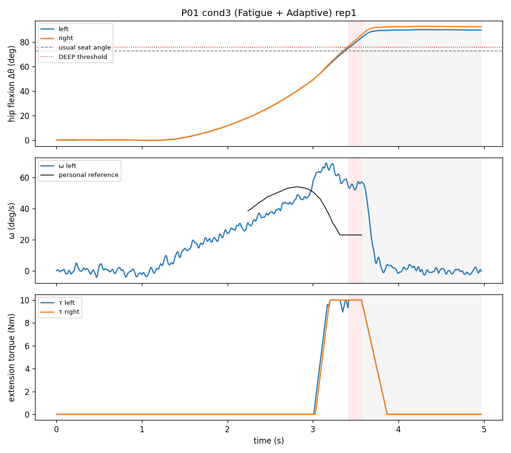
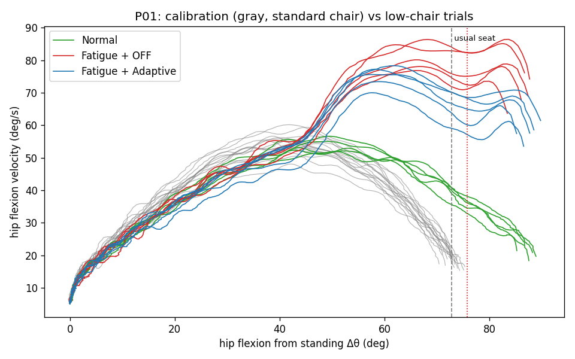

# H10 적응형 착석 보조 (Adaptive Sit-Down Braking)

하지 기능이 떨어진 사용자가 의자에 앉을 때, 고관절이 평소보다 빠르게 굽혀지는 순간 H10이 **고관절 신전 방향 토크**를 주어 하강을 늦추는 알고리즘입니다. 사람을 들어 올리는 것이 아니라, 너무 빨리 굽혀지는 것을 막는 **전자식 브레이크** 역할만 합니다.

- 표준 높이 의자에서 평소처럼 **10~15번 앉은 데이터**로 개인 기준을 만듭니다.
- 착석 중 속도가 개인 기준보다 빠르면 정도에 따라 **약한 제동 → 강한 제동**을 줍니다.
- **평소 엉덩이가 닿던 각도를 지나서도 계속 내려가면 낮은 의자로 판단**하고 더 강하게 제동합니다. 의자 높이를 따로 입력할 필요가 없습니다.
- 입력은 좌/우 고관절 각도뿐이고, 의자 압력센서는 있으면 사용합니다. 출력은 좌/우 신전 토크(Nm)입니다.

> ⚠️ **인체 실험 데이터 보호:** `data/`와 `results/`는 `.gitignore`에 들어 있어 커밋되지 않습니다. 실제 참가자 데이터는 참가자 ID로만 저장하고, 이름 등 개인정보는 파일에 넣지 마세요.

---

## 1. 빠른 시작

```bash
pip install -r requirements.txt
python simulate_data.py --out data --participants 12   # 가짜 데이터 (실험 전 확인용)
python evaluate.py data --out results                  # 지표 계산 → results/report.md
python evaluate.py data --out results --plot P01 3 1   # 한 시행 그래프
python -m pytest -q                                    # 테스트
```

## 2. 실험 절차와 파일 구조

| 순서 | 조건 | 의자 | H10 | 파일 |
|---|---|---|---|---|
| 0 | 캘리브레이션 10~15회 | 표준 (무릎 높이 100%) | 토크 0 | `calib_rep01.csv` … |
| 1 | Normal | 낮은 의자 (무릎 높이 약 75~80%) | 그림자 모드 | `cond1_rep01.csv` … |
| 2 | Fatigue + H10 OFF | 낮은 의자 | 그림자 모드 | `cond2_rep01.csv` … |
| 3 | Fatigue + Adaptive H10 | 낮은 의자 | 보조 ON | `cond3_rep01.csv` … |

- 캘리브레이션이 끝나면 바로 `python calibrate.py data/P01`을 실행해 `profile.json`을 만들고, 정상 착석에서 제동이 잘못 켜지는 비율을 확인합니다.
- **그림자 모드**(`shadow=True`)는 알고리즘이 계산과 기록은 하지만 토크는 0으로 내보내는 모드입니다. OFF 조건도 같은 기준으로 비교할 수 있습니다.
- 조건 2와 3은 피험자마다 순서를 바꾸거나, 각 조건 직전에 피로를 다시 유발하세요.
- 모든 시행에서 팔짱을 끼고, 발 위치는 바닥에 표시하며, 지시는 "평소 속도로 앉으세요"로 고정합니다.

```
data/
  P01/
    meta.json            무릎 높이, 의자 높이(cm) 등. 이름은 넣지 않음
    calib_rep01.csv ...
    profile.json         calibrate.py가 만듦
    cond1_rep01.csv ...
```

**CSV 열** (100 Hz 이상)

| 열 | 필수 | 내용 |
|---|---|---|
| `time_s` | ✅ | 시간 (s) |
| `hip_l_deg`, `hip_r_deg` | ✅ | 고관절 굴곡 각도 (굽힐수록 +) |
| `seat` | 권장 | 의자 압력센서 0/1. 없으면 속도가 멈춘 시점으로 착석을 판단 |
| `tau_cmd_l`, `tau_cmd_r` | 권장 | 알고리즘이 계산한 토크 (그림자 모드 포함) |
| `phase`, `level`, `z_l`, `z_r`, `omega_ref_l`, `omega_ref_r` | 선택 | 알고리즘 판단 기록 |

## 3. 알고리즘



**캘리브레이션** (`Profile.from_trials`)
1. 서 있을 때 각도를 0으로 놓고 Δθ(서 있을 때 대비 굴곡 각도)로 정규화
2. 착석 시작: 양쪽 각속도가 5 deg/s 이상으로 0.1초 이상 유지 / 착석: 압력센서 또는 속도 정지
3. Δθ를 5° 구간으로 나누고, 구간별 평소 각속도의 평균과 SD를 좌우 따로 계산
4. 평소 엉덩이가 닿는 각도(평균 ± SD)와 평소 최대 각가속도 저장

**실시간 제어** (`SitAssistController.update`, 샘플 하나당 수십 µs)

| 단계 | 조건 | 비교 기준 |
|---|---|---|
| STANDING | 서 있음 | 토크 0 |
| DESCENT | 착석 시작 이후 | 0.05초 뒤 각도에서의 개인 평균 속도 |
| DEEP | 평소 착석 각도 + 2SD를 넘었는데 아직 앉지 않음 (낮은 의자) | 평소 착석 순간 속도. gain ×1.5 |
| SEATED | 압력센서 ON 또는 속도 정지 | 0.3초에 걸쳐 토크를 0으로 감소 |

- 점수 `z = (예측 속도 − 기준 속도) / 기준 SD`
- `z < 2.5`이면 보조 없음, `2.5 ≤ z < 4`이면 약한 제동, `z ≥ 4`이면 강한 제동. 토크는 `2.5 Nm × (z − 2.5)`이고 상한은 `tau_max`입니다.
- 평소보다 훨씬 큰 각가속도(평소 최대 + 3SD)가 나오면 그 구간과 상관없이 강한 제동을 겁니다.
- 평소 착석 각도의 25% 전까지는 제동하지 않습니다 (초반은 개인차와 잡음이 큼).
- 토크가 늘어나는 속도는 60 Nm/s로 제한됩니다. 일어서는 중(굴곡 속도 < 0)에는 토크가 항상 0입니다.

모든 값은 `sit_assist.Config`에서 바꿀 수 있습니다.

## 4. H10에 붙이기

```python
from sit_assist import Profile, SitAssistController

ctrl = SitAssistController(Profile.load("data/P01/profile.json"))   # OFF 조건은 shadow=True
while running:
    t, hip_l, hip_r = h10.read_angles()          # ← H10 SDK 호출로 바꾸기
    tau_l, tau_r = ctrl.update(t, hip_l, hip_r, seat=fsr.read())
    h10.set_torque(-tau_l, -tau_r)               # ← 신전 방향 부호는 SDK 규약에 맞추기
    logger.write(t, hip_l, hip_r, **ctrl.info)   # 판단 기록
```

**안전 확인 사항**
- `Config.tau_max`(기본 10 Nm)는 H10 사양보다 낮게 두고, 첫 실험은 2~3 Nm부터 올려 가세요. 신전 토크가 너무 크면 상체를 뒤로 밀 수 있습니다.
- 첫 착용 시에는 토크 부호가 신전 방향인지 반드시 먼저 확인하세요.
- 보조자가 옆에 서 있고, 긴급 정지 버튼이 손에 닿는 상태에서 진행하세요.

## 5. 가짜 데이터로 확인한 결과

> 아래 숫자는 **직접 만든 단순 모델**에서 나온 것입니다. 모델 파라미터(피로 시 근력 부족 20~30 Nm, H10 상한 10 Nm 등)가 결과를 크게 좌우하므로, 효과 크기의 근거로 쓰면 안 됩니다. 코드 전체가 설계대로 동작하는지 확인하는 용도입니다.



참가자 12명 × 조건 3개 × 5회 (낮은 의자), 캘리브레이션은 참가자당 15회 (표준 의자).

| 지표 | Normal | Fatigue + OFF | Fatigue + Adaptive |
|---|---|---|---|
| 최대 굴곡 속도 (deg/s) | 64.8 (8.4) | 85.7 (6.6) | 83.1 (8.3) |
| 최대 각가속도 (deg/s²) | 71.8 (12.4) | 133.3 (15.0) | 133.8 (16.2) |
| RMS jerk (deg/s³) | 305 (54) | 948 (97) | 824 (68) |
| 착석 순간 속도 (deg/s) | 27.7 (4.8) | 75.6 (5.8) | 63.6 (6.9) |
| 착석 시간 (s) | 2.02 (0.28) | 1.78 (0.17) | 1.81 (0.22) |

- Adaptive를 적용하자 OFF 대비 **착석 순간 속도가 −16%**(12명 모두 감소), **jerk가 −13%**(12명 모두 감소)였고, 착석 시간은 +1.8%로 거의 늘지 않았습니다.
- **최대 속도 감소는 −3%로 작았습니다.** 이 모델에서는 피로로 인한 가속이 토크가 올라가기 전에 대부분 일어나고, 토크 상한 10 Nm이 부족한 힘(20~30 Nm)보다 작기 때문입니다. 실제 실험에서도 이 지표가 가장 덜 변할 수 있다는 점을 미리 알아두세요.
- 낮은 의자 착석은 모든 조건에서 DEEP 구간으로 감지됐습니다. 정상 착석(calib, leave-one-out 180회)에서 제동이 켜진 비율은 5.0%, 강한 제동은 1.7%, DEEP 오감지는 0.6%였습니다.

## 6. 이 연구로 주장할 수 있는 범위

- ✅ "H10 기반 적응형 제동이 낮은 의자 착석 후반부의 급격한 고관절 굴곡 속도와 jerk를 줄일 수 있는지 검증한다"
- ❌ 낙상 예방, 근력 회복, 재활 효과, 환자 안전성 향상. 건강한 성인의 피로 모델과 2주 실험으로는 입증할 수 없습니다.

## 7. 파일

| 파일 | 내용 |
|---|---|
| `sit_assist.py` | 신호 처리, 착석 단계 판단, 개인 기준(Profile), 실시간 컨트롤러 |
| `calibrate.py` | 현장용: calib 데이터 → `profile.json` 생성 + 오탐 확인 |
| `simulate_data.py` | 가짜 착석 데이터 생성 (컨트롤러를 넣은 폐루프 시뮬레이션) |
| `evaluate.py` | 지표 계산, 조건 비교, 그래프 |
| `test_sit_assist.py` | 테스트 |
