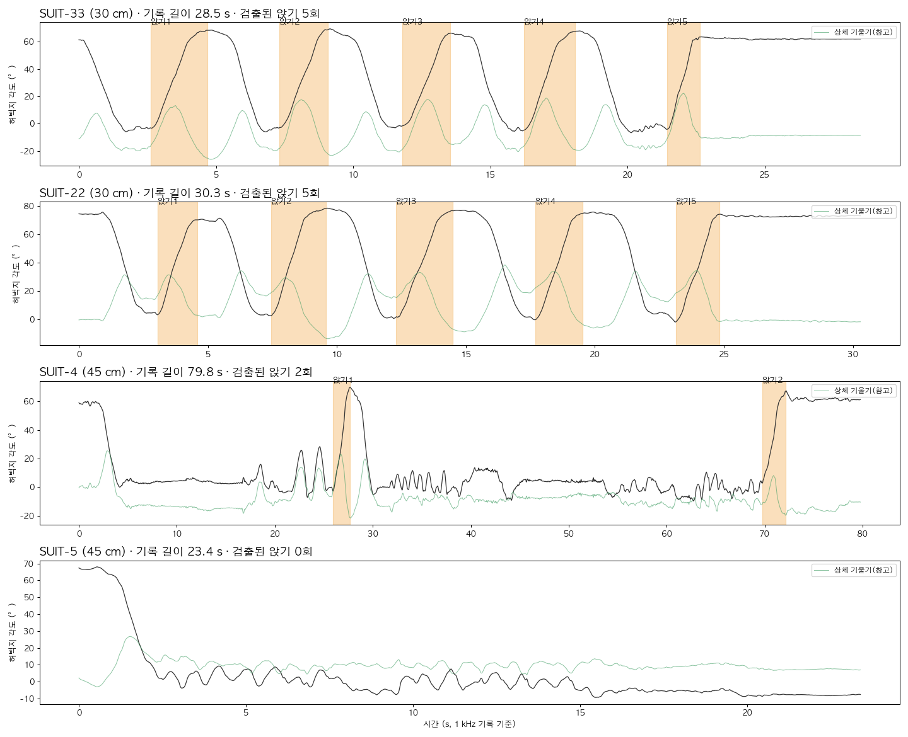

# Low-Chair Sit Assist — 낮은 의자 착석을 위한 H10 적응형 하강 제동 알고리즘

팀 KWAI (이지우, 이지석, 박수민) · 지도교수 고찬영 · 2026 광운대학교 매치업 심화과정 - 인체데이터분석 및 실습

> 이 프로젝트는 근감소증 일반이 아니라, **낮은 의자에 앉는 순간의 급하강**을 다루는 알고리즘입니다.
> H10이 평소 착석 패턴을 개인 기준으로 학습하고, 평소보다 깊이 내려가는(낮은 의자) 순간과 평소보다 빨라지는 순간에 고관절 신전 토크로 하강을 늦춥니다.

- 발표 슬라이드 (Figma): https://www.figma.com/slides/4tZDoTD6FXxpx83Z0kraKR
- 포스터: [`poster/착석보조_포스터.pptx`](poster/착석보조_포스터.pptx) ([미리보기](poster/poster_preview.png))
- **H10에 넣을 코드: [`firmware/`](firmware/)** (C, 1 kHz 제어 루프용)


## 왜 낮은 의자인가

같은 사람이 45 cm 의자와 30 cm 의자에 앉은 H10 실측에서, **30 cm 의자는 허벅지가 평균 9.1° 더 굽혀진 뒤에야 의자에 닿았습니다**(62.7° → 71.8°).

| | 내용 |
|---|---|
| 더 깊이 굽혀야 합니다 | 실측에서 30 cm 의자는 45 cm보다 허벅지가 9° 더 굽혀졌습니다. |
| 더 오래, 더 숙여서 버텨야 합니다 | 의자가 낮을수록 동작 시간이 길어지고(40 cm 1.6초 → 30 cm 2.0초) 상체를 더 숙여야 합니다(34.6° → 약 39°)[^yoshioka]. |
| 마지막 순간이 가장 빠릅니다 | 제동이 풀리면 착석 직전에 속도가 붙어 의자에 세게 부딪히거나 뒤로 넘어지기 쉽습니다. |
| 생활 곳곳에 있습니다 | 소파, 좌변기, 좌식 의자처럼 매일 앉는 자리가 낮습니다. |
| 손으로 짚으면 되지 않나요? | 팔로 버티는 것은 하지 기능 저하를 가리는 보상 전략입니다[^vanderkruk]. 지팡이·짐을 든 상황이나 팔걸이 없는 소파·좌변기에서는 쓸 수 없습니다. |

그래서 알고리즘에는 **DEEP 단계(평소 착석 각도 + 2SD를 넘어 계속 내려감 → 낮은 의자로 판단, 제동 1.5배)** 가 있습니다.

## 1. 타깃 사용자

| 항목 | 내용 |
|---|---|
| 대상 | **착석 제어가 어려운 근감소증 위험 고령자.** 근거: AWGS 2019 기준 5회 의자 일어서기 ≥ 12초[^awgs] |
| 신체 특성 | 독립 보행 가능 · 하지 근력 저하 |
| 문제 상황 | 낮은 소파 · 좌변기 · 낮은 의자 |
| 착석 특성 | 착석 후반부에서 하강 속도를 제어하지 못하고 털썩 앉음 |
| 왜 문제인가 | 앉기·일어서기 같은 자세 전환은 고령자 낙상이 자주 일어나는 순간[^robinovitch]. 지역사회 고령자는 앉을 때 젊은 성인보다 상체를 약 10° 덜 숙이고[^dubost], 낙상 고위험 고령자 낙상의 17.6%가 뒤로 주저앉는 방향입니다[^stevens]. |
| 규모 | 한국 70~84세 근감소증 유병률 남 26.8%·여 18.8%[^kim2025], 65세 이상 낙상 경험률 7.2%[^survey2020] |

### 용어


| 용어 | 뜻 |
|---|---|
| 굴곡 · 신전 | 굴곡은 관절을 굽히는 움직임, 신전은 펴는 움직임입니다. 앉을 때 고관절은 굴곡합니다. |
| 고관절 신전근 | 엉덩이의 대둔근과 허벅지 뒤의 햄스트링입니다. 다리를 뒤로 펴는 힘을 냅니다. |
| 편심성 수축 | 근육이 늘어나면서 힘을 내는 수축입니다. 앉을 때 하강 속도를 늦추는 브레이크가 됩니다. 부드럽게 앉을수록 고관절 근육의 기여가 커집니다[^jeon]. |
| 근감소증 | 나이가 들며 근육량과 근력이 함께 줄어드는 질환입니다.[^awgs] |
| IMU | 가속도와 회전 속도로 기울기와 움직임을 재는 관성 센서입니다. |
| 엔코더 (incPosDeg) | 고관절 모터의 회전 센서로 잰 각도입니다. 허벅지 IMU 각도를 빼면 상체 기울기가 됩니다. |
| Δθ | 서 있을 때보다 허벅지가 굽혀진 각도입니다. |
| ω (각속도) | 허벅지가 굽혀지는 속도(°/s)입니다. |
| σ · SD (표준편차) | 여러 번 착석 사이에 값이 흩어진 정도입니다. 2SD 안에 정상 착석의 약 95%가 들어옵니다. |
| z | 지금 속도가 평소 평균보다 표준편차의 몇 배만큼 빠른지 나타냅니다. |
| τ (토크), Nm | 관절을 돌리는 힘과 그 단위(뉴턴미터)입니다. |
| RMS jerk | 가속도가 얼마나 급하게 바뀌는지의 평균 크기입니다. 작을수록 부드럽습니다.[^jerk] |
| leave-one-out | 한 번씩 빼고 나머지로 기준을 만든 뒤, 빼 둔 시행으로 시험하는 교차 검증입니다. |

## 2. 실측 데이터

| 파일 | 의자 | 기록 길이 | 파일 안의 앉기 | 비고 |
|---|---|---|---|---|
| SUIT-33 | 30 cm | 28.5 s | 5회 | |
| SUIT-22 | 30 cm | 30.3 s | 5회 | |
| SUIT-4 | 45 cm | 79.8 s | 2회 | H10 보행 보조가 켜진 상태, 그 외 보행·상체 숙이기 |
| SUIT-5 | 45 cm | 23.4 s | 0회 | 앉은 상태에서 일어나 보행 |



> 실험에서는 의자마다 10~15회 앉았지만, 받은 로그 파일 안에는 위 횟수만 들어 있습니다. 나머지는 다른 번호의 로그 파일에 있을 가능성이 큽니다. 파일을 더 받으면 아래 명령으로 그대로 다시 처리합니다.

```bash
pip install -r requirements.txt
python preprocess_h10.py ~/Downloads/SUIT_LOGGED_DATA-{4,5}.csv  --out data/real/chair45 --include-assist
python preprocess_h10.py ~/Downloads/SUIT_LOGGED_DATA-{22,33}.csv --out data/real/chair30
python compare_chairs.py --out results/real            # 45 cm vs 30 cm 비교, DEEP 판정 검증
python firmware/export_params.py                      # 기준값 → firmware/sit_assist_params.h
python -m pytest -q                                   # 알고리즘 + C/Python 동일성 테스트
```

> ⚠️ **인체 실험 데이터 보호:** `data/`와 `results/`는 `.gitignore`에 들어 있어 커밋되지 않습니다.

### 신호와 전처리

| 알고리즘 입력 | H10 필드 | 설명 |
|---|---|---|
| `thigh_l_deg`, `thigh_r_deg` | `thighDeg_LH`, `thighDeg_RH` | IMU 허벅지 절대 각도 |
| `trunk_deg` | 좌우 평균 `incPosDeg − thighDeg` | 고관절 엔코더 각 − 허벅지 각 = 골반·상체 기울기 |
| 보조 여부 확인 | `u_LH`, `u_RH` | 보조 토크가 켜져 있던 앉기 표시 |

- 로그는 1 kHz이고 10샘플 평균으로 100 Hz로 바꿉니다. 디코딩 결과는 수업 디코더와 반올림 오차(0.0005) 수준에서 일치합니다.
- 일어선 뒤 바로 다시 앉아 서 있는 시간이 짧아서, 앉기 구간은 **직전에 가장 똑바로 선 순간**부터 자릅니다.
- 앉은 뒤에도 몸이 흔들려 착석 판정을 `|ω| < 8°/s, 0.15 s`로 완화했습니다.
- 좌우 허벅지 각도가 10° 가까이 차이 나서 기준 조회는 좌우 평균 Δθ로 합니다.

## 3. 실측 결과

| 지표 | 45 cm (2회) | 30 cm (10회) | 차이 |
|---|---|---|---|
| 착석 각도 Δθ (°) | 62.7 ± 2.1 | 71.8 ± 3.4 | **+9.1** |
| 최대 허벅지 굴곡 속도 (°/s) | 81 ± 22 | 70 ± 11 | −11 |
| 착석 순간 속도 (°/s) | 11.6 ± 2.3 | 10.6 ± 1.8 | −1.0 |
| 착석 시간 (s) | 1.82 ± 0.2 | 1.61 ± 0.3 | −0.21 |
| 최대 상체 숙임 (°) | 22.4 ± 5.4 | 23.2 ± 13.9 | +0.8 |
| 낮은 의자(DEEP) 판정 | 0 / 2 | **9 / 10** | |


- **낮은 의자 판정:** 45 cm 착석 각도로 정한 DEEP 기준(66.9°)으로 30 cm 착석 10회 중 9회를 낮은 의자로 판정했고, 45 cm 2회는 잘못 판정하지 않았습니다.
- **정상 착석 오작동:** 30 cm 착석 10회를 하나씩 빼고 기준을 만들어 재생했을 때 8회는 제동이 켜지지 않았습니다. 켜진 2회는 실제로 빠르게(1.0 s, 99°/s) 또는 깊게 앉은 시행입니다.
- 피험자가 건강한 성인이라 30 cm에서도 하강 속도를 스스로 잘 제어했습니다. 그래서 속도 차이는 작았고, 착석 각도 차이가 가장 컸습니다.
- 45 cm 착석 2회는 H10 보행 보조가 켜진 상태였습니다. 기준값으로 쓰기에는 횟수가 적다는 한계가 있습니다.
- **제동 효과(속도·jerk 감소)는 아직 실측하지 않았습니다.** 아래 4장의 코드를 H10에 넣고 30 cm 의자에서 OFF / ON을 비교해 확정합니다.

## 4. H10에 넣기 (`firmware/`)

| 파일 | 내용 |
|---|---|
| `sit_assist.h`, `sit_assist.c` | 알고리즘 본체. 동적 메모리 없음, 상태는 구조체 하나 |
| `sit_assist_params.h` | 실측 기준값(하강 속도 표, DEEP 기준 66.9° 등). `export_params.py`가 만듦 |
| `export_params.py` | `results/real/profile_45ref.json` → 헤더 |
| `test_firmware.py` | 실측 착석 12회에서 C와 Python 토크가 같은지 확인 (double 1e-6 Nm, float 0.05 Nm 이내) |

```c
#include "sit_assist.h"
static SA_State sa;

void controller_init(void) { sa_init(&sa); }

void controller_1khz(void)              /* H10 제어 루프 */
{
    float tau[2];                        /* 왼쪽·오른쪽 신전 토크 (Nm) */
    sa_step_1khz(&sa, thighDeg_LH, thighDeg_RH, incPosDeg_LH, incPosDeg_RH, tau);
    u_LH = SA_EXT_SIGN_L * SA_TORQUE_TO_U * tau[0];
    u_RH = SA_EXT_SIGN_R * SA_TORQUE_TO_U * tau[1];
    free_var1 = sa_log_state(&sa);      /* 단계*10 + 제동 단계 (0 서 있음, 1 내려감, 2 DEEP, 3 착석) */
    free_var2 = sa_log_torque(&sa);     /* 계산한 토크 (Nm) */
}
```

**반드시 확인할 설정** (`sit_assist.h` 맨 위, 컴파일 옵션 `-D`로 바꿀 수 있음)
- `SA_TORQUE_TO_U`: Nm를 `u_RH/u_LH` 제어 입력으로 바꾸는 계수입니다. 수업 SDK의 단위를 확인해 넣으세요.
- `SA_EXT_SIGN_L/R`: 신전 방향 부호입니다. 첫 착용 때 가장 낮은 토크로 방향부터 확인하세요.
- `SA_TAU_LIMIT`: 안전 상한입니다. 기본 2 Nm에서 시작해 단계적으로 올리세요.
- `SA_SHADOW=1`: 계산과 로그만 하고 토크는 0입니다. **OFF 조건**은 이 설정으로 같은 코드를 돌리면 판정 기록까지 같은 형식으로 남습니다.
- 보조자가 옆에 서 있고, 긴급 정지 버튼이 손에 닿는 상태에서 진행하세요.

### OFF / ON 비교

```bash
python compare_h10_runs.py --off <OFF 로그들> --on <ON 로그들> --out results/h10_onoff
```

원본 hex 로그와 디코딩된 CSV를 모두 받습니다. 앉기를 자동으로 찾아 최대 허벅지 굴곡 속도, 착석 순간 속도, 최대 각가속도, RMS jerk, 착석 시간, 최대 상체 숙임을 OFF와 ON으로 나눠 표로 만듭니다. `free_var1/2`가 기록돼 있으면 DEEP 판정과 토크도 함께 봅니다.

## 5. 알고리즘

**FSM**

| 상태 | 들어가는 조건 | 하는 일 |
|---|---|---|
| STANDING | 시작 / 착석 후 Δθ < 10° / 얕을 때 다시 일어섬 | 토크 0, 기준 자세 갱신 |
| DESCENT | 양쪽 허벅지 ω > 5°/s, 0.1 s 유지 | 상체 지지 + 개인 기준 대비 제동 |
| DEEP | Δθ > 평소 착석 각도 + 2SD (실측 66.9°), 아직 착석 전 | 평소 착석 순간 속도까지 감속, 제동 gain ×1.5 |
| SEATED | 압력센서 ON, `|ω| < 8°/s` 0.15 s, 또는 깊이 내려간 뒤 펴지기 시작 | 0.3초에 걸쳐 토크 해제 |

**토크**
- 상체 지지: `τ_s = 6 Nm × sin φ`
- 적응형 제동: `z = (ω̂ − ω_ref(θ̂)) / σ(θ̂)`, `τ_b = 2.5 Nm × g × max(0, z − 3.5)`
  - 0.05초 뒤의 속도와 각도를 예측해서 미리 반응합니다.
  - DEEP이거나 상체를 평소보다 덜 숙였으면 `g = 1.5`입니다. 급가속이면 `z ≥ 5`로 처리합니다.
- 출력: `τ = clip(τ_s + τ_b, 0, 10 Nm)`, 상승 속도 ≤ 60 Nm/s, 일어설 때는 0. 펌웨어에서는 `SA_TAU_LIMIT`로 한 번 더 제한합니다.

**기준값:** 하강 속도 표는 30 cm 착석 10회, 평소 착석 각도(DEEP 기준)는 45 cm 착석 2회로 만들었습니다. 임계값 z 3.5는 실측 정상 착석을 하나씩 빼고 재생한 결과(10회 중 8회는 z ≤ 3.2)로 정했습니다.

## 6. 주장할 수 있는 범위

- ✅ "낮은 의자에서는 착석 각도가 더 깊어지고(실측 +9°), H10 알고리즘이 이를 낮은 의자로 판정한다(9/10)"
- ✅ "H10 기반 적응형 제동이 낮은 의자 착석 후반부의 급하강을 줄이는지 OFF / ON으로 검증한다"
- ❌ 낙상 예방, 근력 회복, 재활 효과. 짧은 실험과 건강한 성인 실험으로는 입증할 수 없습니다.

## 7. 파일

| 파일 | 내용 |
|---|---|
| `h10_decode.py` | H10 SUIT hex 로그 디코더 |
| `preprocess_h10.py` | 1 kHz → 100 Hz, 앉기 자동 검출 |
| `compare_chairs.py` | 실측 45 cm vs 30 cm 비교, DEEP 판정 검증 |
| `sit_assist.py` | 신호 처리, FSM, 개인 기준(Profile), 실시간 컨트롤러 (Python 기준 구현) |
| `firmware/` | H10용 C 구현, 기준값 헤더, 동일성 테스트 |
| `compare_h10_runs.py` | H10 OFF / ON 로그 비교 |
| `calibrate.py` | 착석 기록 → `profile.json` + 정상 착석 오작동 확인 |
| `evaluate.py` | 지표 계산 (최대 속도, jerk, 착석 순간 속도 등) |
| `simulate_data.py` | (참고) 근력 저하 사용자 모델 시뮬레이션. 발표 결과에는 쓰지 않음 |
| `poster/`, `presentation/` | 포스터·발표 자료와 그림 생성 스크립트 |
| `docs/slides/` | Figma 발표 슬라이드 캡처 |

## 참고문헌

[^robinovitch]: Robinovitch SN, Feldman F, Yang Y, et al. Video capture of the circumstances of falls in elderly people residing in long-term care: an observational study. *Lancet*. 2013;381(9860):47–54.
[^awgs]: Chen LK, Woo J, Assantachai P, et al. Asian Working Group for Sarcopenia: 2019 Consensus Update on Sarcopenia Diagnosis and Treatment. *J Am Med Dir Assoc*. 2020;21(3):300–307.e2.
[^yoshioka]: Yoshioka S, Nagano A, Hay DC, Fukashiro S. Peak hip and knee joint moments during a sit-to-stand movement are invariant to the change of seat height within the range of low to normal seat height. *BioMed Eng OnLine*. 2014;13:27. (젊은 성인 8명, 일어서기 동작)
[^dubost]: Dubost V, Beauchet O, Manckoundia P, et al. Decreased trunk angular displacement during sitting down: an early feature of aging. *Phys Ther*. 2005;85(5):404–412.
[^stevens]: Stevens JA, Mahoney JE, Ehrenreich H. Circumstances and outcomes of falls among high risk community-dwelling older adults. *Inj Epidemiol*. 2014;1:5.
[^vanderkruk]: van der Kruk E, Silverman AK, Reilly P, Bull AMJ. Compensation due to age-related decline in sit-to-stand and sit-to-walk. *J Biomech*. 2021;122:110411.
[^jeon]: Jeon et al. *Front Hum Neurosci*. 2024. 앉기는 일어서기의 역동작이 아니라 하강 중 균형 제어가 필요한 동작이며, 부드럽게 앉을수록 고관절 근육의 기여가 커집니다 (젊은 성인 12명).
[^kim2025]: Kim et al. *Medicina*. 2025;61(6):1065 (Kim & Won 2020 재인용).
[^survey2020]: 보건복지부. 2020 노인실태조사 (언론 보도 재인용).
[^jerk]: Balasubramanian S, Melendez-Calderon A, Roby-Brami A, Burdet E. On the analysis of movement smoothness. *J NeuroEng Rehabil*. 2015;12:112.
