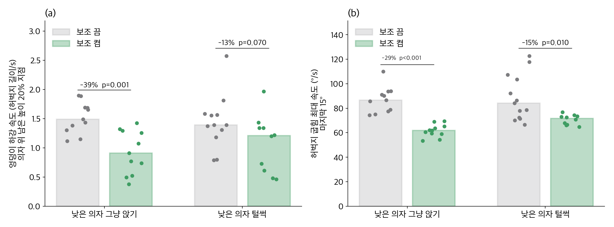
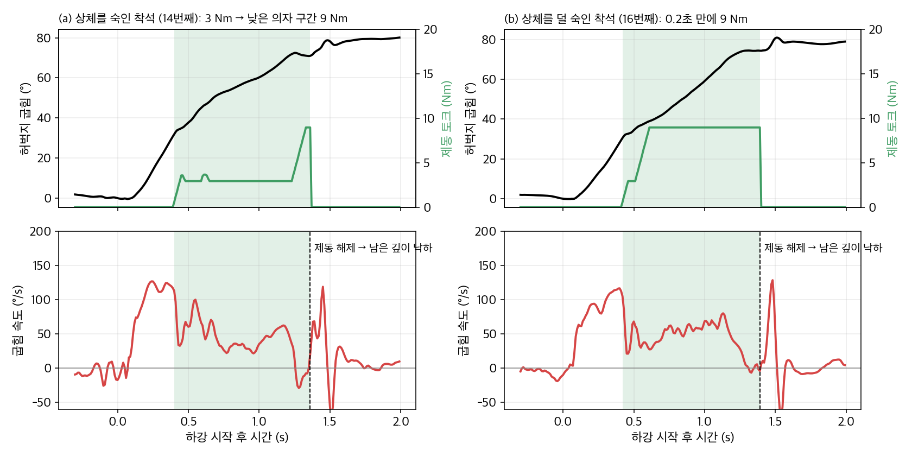

# 3차 실측 펌웨어: 구간 제동 + 연구 결과로 세기 조절

2차 실측(11/9)에 H10에서 돌린 `device_2nd_test`를 그대로 뼈대로 두고, **구간 안의 제동 세기만** 연구 결과로 바꿨습니다.
함수 이름과 인자가 같아서 SDK 쪽 코드는 바꾸지 않고 세 파일(`sit_assist.c/.h`, `sit_assist_params.h`)만 바꿔 넣으면 됩니다.
1차 → 2차 → 3차가 어떻게, 왜 바뀌었는지와 기록 재생 방법은 [`../알고리즘_변천.md`](../알고리즘_변천.md)에 있습니다.

## 무엇이 같고 무엇이 바뀌었나

| | 2차 (11/9 실측) | 3차 |
|---|---|---|
| 제동 구간 | 허벅지 25°~70°, 두 허벅지가 함께 10°/s 넘게 굽혀질 때. 한 번 내려갈 때 한 번, 70° · 착석 · 60 ms 멈춤이면 끝 | **같음.** 단, 낮은 의자로 판정되면 착석(최대 95°)까지 연장 |
| 구간 안 세기 | 항상 9 Nm | **기본 3 Nm + 6 Nm × 위험도(0~1)** → 3~9 Nm |
| 위험도 | 없음 | 아래 셋 중 가장 큰 값 |
| 안전 | 상한 9 Nm, 늘어나는 속도 60 Nm/s, 구간 밖 0 | 같음 |

**위험도 = max(①, ②, ③)**

| 신호 | H10에서 어떻게 | 연구 근거 | 위험도 0 → 1 |
|---|---|---|---|
| ① 속도 | 허벅지 굽힘 속도를 평소 30회의 같은 각도 속도와 비교한 z 점수 | 빨리 내려갈수록 카메라 CoM이 뒤로 (ρ −0.60) | z 1.0 → 3.5 |
| ② 추정 CoM | 허벅지 각도 + 상체 숙임 + 정강이 17° 가정 + Winter 분절 무게 비율로 CoM–발목 거리를 계산하고, 같은 허벅지 각도에서 평소 상체 숙임일 때보다 얼마나 뒤인지 | H10 추정 CoM과 카메라 CoM r 0.74. 상체를 덜 숙이면 커지며 털썩 주저앉기를 약 1초 전에 알려 줌 | 다리 길이의 1% → 3% 뒤 |
| ③ 낮은 의자 | 허벅지가 평소 최대 깊이 69.4°를 넘음 | 30 cm에서 10.7° 더 깊이 앉음 | 넘으면 1 |

## 기록 재생 결과 (카메라 CoM과 함께 찍은 착석 60회)

```bash
python firmware/replay_3rd_test.py
```

엉덩이가 닿기 전 3초 동안의 토크입니다.


 기준값은 첫 번째 피험자의 45 cm 평소 착석 30회입니다.

| | 그냥 앉기 평균 토크 | 털썩 주저앉기 평균 토크 | 털썩: 6 Nm 이상이 걸린 시점 |
|---|---|---|---|
| 2차 · 첫 번째 피험자 45 cm | 7.2 Nm | 8.4 Nm | 닿기 1.2초 전 |
| **3차 · 첫 번째 피험자 45 cm** | **3.2 Nm** | **7.0 Nm** | 닿기 1.0초 전 |
| 3차 · 첫 번째 피험자 30 cm | 3.9 Nm | 7.9 Nm | 닿기 1.1초 전 |
| 3차 · 두 번째 피험자 30 cm (본인 기준 없음) | 4.9 Nm | 5.9 Nm | 닿기 0.4초 전 |

- 평균 토크와 카메라 CoM(닿을 때)의 관계: 2차 ρ −0.22 (p 0.09, 관계 없음) → **3차 ρ −0.61 (p < 0.001)**. CoM이 뒤로 빠지는 착석일수록 세게 제동합니다.
- 두 번째 피험자는 첫 번째 피험자 기준으로 돌려서 차이가 작습니다. **실측 전에 그 사람의 평소 착석으로 기준을 다시 만들어야** 합니다(아래 1단계).
- 같은 데이터로 기준과 문턱값을 본 결과라, 실제 효과는 3차 실측으로 확인해야 합니다.

## v3 실측 결과 (11/12): 낮은 의자, 보조 끔 · 켬



같은 착용자가 같은 날 같은 낮은 의자에 앉았습니다(조건별 10~13회). (a)는 옆 영상에서 포즈 추정으로 구한 엉덩이 하강 속도로, 의자 위 남은 높이 20% 지점의 값이며 단위는 허벅지 길이/s입니다. (b)는 H10의 마지막 15° 허벅지 최대 속도입니다.

| | 영상 (a) | H10 (b) |
|---|---|---|
| 그냥 앉기 끔 → 켬 | 1.49 → 0.91, **−39%** (p 0.001) | 87 → 62°/s, **−29%** (p < 0.001) |
| 털썩 끔 → 켬 | 1.39 → 1.21, −13% (p 0.07) | 84 → 72°/s, **−15%** (p 0.01) |

- 하강 시간: 그냥 1.15 → 1.42 s, 털썩 1.24 → 1.70 s (p 0.001).
- 상체: 허벅지 25° 통과 0.6 s 뒤 켬 +13~20°, 끔 +3~5° (p ≤ 0.005). 9 Nm 버전에서 보이던 젖혀짐이 없습니다.
- 제동은 최종 95~100° 중 90~93°까지 이어졌고, 풀린 뒤 3.6~4.4°만 60°/s 이하로 내려앉았습니다.
- 영상과 로그는 앉는 간격으로 맞췄습니다. 끔 로그(보조 세기 0)는 첫 11회가 그냥 앉기, 뒤 13회가 털썩입니다. 끔 털썩에서도 모터 전류가 −1.2~−2.8 A 흘러, 끔이 완전한 0 토크는 아니었을 수 있습니다.

## v3 (11/12 Third_v2 실측 뒤): 상체 보호 · 속도 비례 · 부드러운 시작과 해제



착용자 느낌: "다리가 아니라 갈비뼈 쪽을 들어 올린다", "내려가다 한 번 들썩", "앉기 직전 튕김". 로그(21회)에서 확인한 원인과 바꾼 것입니다.

| 느낌 | 로그에서 본 것 | v3에서 바꾼 것 (매크로) |
|---|---|---|
| 갈비뼈를 들어 올림 | 센 제동 12회에서 상체가 0.6 s 동안 11° 숙임 → −9°(서 있을 때보다 뒤). 약한 제동 9회는 10° 근처 유지 (p 0.001). 고관절 토크의 반작용이 허리 프레임을 통해 상체를 민다 | **상체 보호**: 구간 시작 때보다 5° 넘게 젖혀지면 줄이고 10°면 0 (`SA_TRUNK_GUARD_START/FULL` 5/10). **최대 9 → 6 Nm** (`SA_RISK_BRAKE`) |
| 내려가다 들썩 | 구간이 열리고 40 ms 안에(명령 2~3 Nm) 허벅지 속도 133 → 25 → 98°/s. 보조 없는 착석엔 없음 → 기어 유격 · 스트랩이 한 번에 걸림 | **미리 당겨두기** 1 Nm (허벅지 10°부터 구간 전까지, `SA_PRELOAD`, `SA_PRELOAD_FROM`). **오르는 속도** 60 → 30 Nm/s (`SA_RISE_RATE_V3`) |
| 앉기 직전 튕김 | 제동이 의자 위 약 7°에서 몸을 멈춰 세움(속도 0, 때로 위로) → 0.06 s 멈춤 규칙으로 0.08 s 만에 해제 → 남은 6~10°를 120~140°/s로 낙하 | **속도 비례**: 허벅지 속도 30°/s 이상에서 전부, 느려지면 비례해 줄고 멈추면 0 (`SA_DAMP_FULL_VEL`). 멈춤 종료 0.06 → 0.5 s (`SA_BRAKE_PAUSE_HOLD`). **해제** 0.3 s에 걸쳐 (`SA_RELEASE_V3_S`) |

- 추정 CoM 위험도는 유지합니다(`SA_USE_COM_RISK` 1). 빼면 카메라 60회 재생에서 위험한 착석을 골라 거는 성질이 사라집니다(ρ +0.25). "제동 → 상체 젖혀짐 → CoM 위험↑ → 더 센 제동" 순환은 상체 보호 배율이 곱해져 끊깁니다.
- 카메라 CoM 60회 재생(보조 없이 앉은 기록, 미리 당김 1 Nm 제외): 그냥 앉기 평균 2.7~3.4 Nm · 털썩 3.5~4.7 Nm, 평균 토크와 카메라 CoM **ρ −0.44 (p < 0.001)**. 이전 3차(최대 9 Nm)는 −0.61~−0.64였으니, 상체를 보호하는 대신 구분력이 조금 줄었습니다.
- 이 재생은 보조 없이 앉은 기록이라, v3 토크가 실제로 상체를 얼마나 덜 젖히는지는 실측으로 확인해야 합니다.
- 서 있을 때(착석 밖) 최대 토크는 미리 당김 1 Nm입니다.

## 11/12 실측에서 찾아 고친 것: 제동이 내려가는 도중에 풀림


- **증상:** 실험 착석 20회(45 cm 쪽 10회, 낮은 의자 10회) 모두 엉덩이가 닿기 전에 제동이 풀렸습니다. 낮은 의자 10회 중 7회는 최종 95~101° 중 37~51°에서 풀렸고, 풀린 뒤 186~256°/s로 떨어졌습니다(그림 (b)). 착용자가 말한 "앉고 나서 풀리는 느낌"은 실제로는 앉기 전에 풀린 것이었습니다.
- **원인:** 제동이 걸리면 몸이 갑자기 느려지면서 허리 IMU 가속도가 튑니다(고역 통과 > 3 m/s²). 코드는 이 튐을 '엉덩이가 의자에 닿음(충격)'으로 보고 착석으로 넘어가 구간을 닫았습니다.
- **수정:** 충격만으로는 착석으로 보지 않습니다. 충격 뒤 0.3 s 안에 허벅지 속도가 20°/s 아래로 0.08 s 이어져야(=실제로 멈춰야) 착석입니다. 계속 내려가면 충격을 무시하고 제동을 유지합니다.
  `SA_IMPACT_CONFIRM_VEL` 20 · `SA_IMPACT_STILL_N` 8 · `SA_IMPACT_CONFIRM_N` 30
- **확인:** 11/12 로그를 수정 코드로 재생하면 20회 모두 원래 풀리던 순간에 더는 풀리지 않습니다. 13회는 착석 직전(최종 각도 2° 이내)까지 구간이 이어집니다. 나머지 7회는 기록상 원래 제동이 풀린 뒤 허벅지가 크게 출렁여 '멈춤' 규칙으로 끝나는데, 이 부분은 보조가 풀린 뒤의 움직임이라 재생으로 판단할 수 없고 다시 실측해야 합니다.
  카메라 CoM 60회 재생 결과는 거의 같습니다 (ρ −0.61 → −0.63).
- **또 하나: 위험도가 처음부터 1.** 기준값이 첫 번째 피험자의 것이라, 이번 착용자의 하강 속도(130~250°/s)가 모두 '평소보다 훨씬 빠름'으로 계산돼 구간이 열리자마자 9 Nm였습니다. **착용자가 바뀌면 아래 1단계로 기준값을 꼭 다시 만들어야** 3차의 '평소엔 약하게'가 동작합니다.

## 실측 순서

1. **기준값**: 착용자가 바뀌면 `SA_SHADOW=1`로 45 cm에 평소처럼 30회 앉고,
   `python preprocess_h10.py 로그.csv --out data/real/S0X` → `python calibrate.py data/real/S0X` →
   `python firmware/export_params.py --profile data/real/S0X/profile.json --out firmware/device_3rd_test/sit_assist_params.h`
2. **확인 (그림자 모드 `-DSA_SHADOW=1`)**: 서기 → 앉기 5회. `free_var2`(계산 토크)가 그냥 앉기에서 3 Nm 근처, 일부러 상체를 세우고 털썩 앉으면 9 Nm 근처로 오르는지 봅니다.
3. **본 실험 (`-DSA_SHADOW=0`)**: 45 cm · 30 cm × 그냥 · 털썩 × 보조 OFF · ON, 조건당 10회 이상. 옆 카메라 고정 촬영.
4. **비교할 것**
   - 그냥 앉기 토크가 2차(9 Nm)보다 낮은가 → 평소에는 덜 개입
   - 털썩 주저앉기에서 9 Nm 가까이, 닿기 전에 걸리는가
   - 닿기 직전 하강 속도: 털썩 · 낮은 의자에서 OFF보다 줄었는가 (2차와 같은 영상 분석)

로그 `free_var1` = 단계×10 + 위험도 단계(0 낮음 · 1 중간 · 2 높음) + 5(상체 덜 숙임), `free_var2` = 토크(Nm).
위험도 자체가 필요하면 `sa_log_risk(&sa)`를 남는 로그 칸에 넣습니다.

## 바꿔 볼 수 있는 값 (`-D`)

| 매크로 | 기본 | 뜻 |
|---|---|---|
| `SA_BASE_BRAKE` | 3.0 | 평소 착석 제동 (Nm). 0이면 위험할 때만 제동 |
| `SA_RISK_BRAKE` | 6.0 | 위험도 1일 때 (Nm). v3에서 9 → 6 |
| `SA_RISK_Z_LO` / `_HI` | 1.0 / 3.5 | 속도 z 위험도 구간 |
| `SA_RISK_COM_LO` / `_HI` | 0.010 / 0.030 | 추정 CoM 뒤로 빠짐 위험도 구간 (다리 길이 배) |
| `SA_DEEP_STOP_DEPTH` | 95 | 낮은 의자일 때 구간 끝 (°) |
| `SA_TAU_LIMIT` | 9.0 | 출력 상한 (Nm) |
| `SA_IMPACT_CONFIRM_VEL` | 20 | 충격 뒤 이 속도(°/s) 아래로 멈춰야 착석 |
| `SA_IMPACT_STILL_N` | 8 | 멈춤이 이어져야 하는 샘플 수 (0.08 s) |
| `SA_IMPACT_CONFIRM_N` | 30 | 충격 뒤 멈춤을 기다리는 샘플 수 (0.3 s) |
| `SA_TRUNK_GUARD_START` / `_FULL` | 5 / 10 | 상체가 구간 시작보다 이만큼(°) 젖혀지면 줄이기 시작 / 0 |
| `SA_DAMP_FULL_VEL` | 30 | 이 허벅지 속도(°/s) 이상이면 제동 전부, 아래면 비례 (0이면 끔) |
| `SA_PRELOAD` / `SA_PRELOAD_FROM` | 1.0 / 10 | 미리 당겨두는 토크 (Nm) / 시작 허벅지 각도 (°) |
| `SA_RISE_RATE_V3` | 30 | 토크가 오르는 속도 (Nm/s) |
| `SA_RELEASE_V3_S` | 0.3 | 구간이 끝난 뒤 0까지 줄이는 시간 (s) |
| `SA_BRAKE_PAUSE_HOLD` | 50 | 이만큼(샘플) 멈춰야 구간 종료 |
| `SA_USE_COM_RISK` | 1 | 추정 CoM 위험도 사용 |
