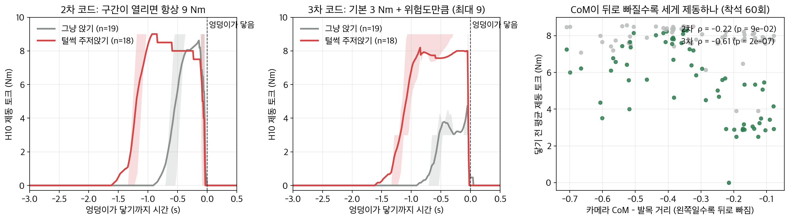
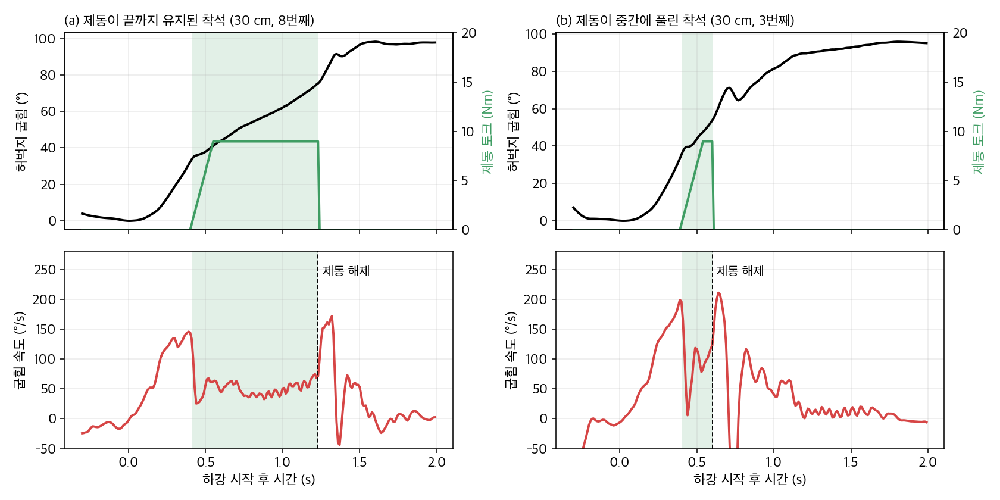

# 3차 실측 펌웨어: 구간 제동 + 연구 결과로 세기 조절

2차 실측(11/9)에 H10에서 돌린 `device_2nd_test`를 그대로 뼈대로 두고, **구간 안의 제동 세기만** 연구 결과로 바꿨습니다.
함수 이름과 인자가 같아서 SDK 쪽 코드는 바꾸지 않고 세 파일(`sit_assist.c/.h`, `sit_assist_params.h`)만 바꿔 넣으면 됩니다.
1차 → 2차 → 3차가 어떻게, 왜 바뀌었는지와 기록 재생 방법은 [`../알고리즘_변천.md`](../알고리즘_변천.md)에 있습니다.

## 무엇이 같고 무엇이 바뀌었나

| | 2차 (11/9 실측) | 3차 |
|---|---|---|
| 제동 구간 | 허벅지 25°~70°, 두 허벅지가 함께 10°/s 넘게 굽혀질 때. 한 번 내려갈 때 한 번, 70° · 착석 · 60 ms 멈춤이면 끝 | **같음.** 단, 낮은 의자로 판정되면 착석(최대 95°)까지 연장 |
| 구간 안 세기 | 항상 9 Nm | **기본 3 Nm + 6 Nm × 위험도(0~1)** → 3~9 Nm |
| 위험도 | 없음 | 아래 셋 중 가장 큰 값 |
| 안전 | 상한 9 Nm, 늘어나는 속도 60 Nm/s, 구간 밖 0 | 같음 |

**위험도 = max(①, ②, ③)**

| 신호 | H10에서 어떻게 | 연구 근거 | 위험도 0 → 1 |
|---|---|---|---|
| ① 속도 | 허벅지 굽힘 속도를 평소 30회의 같은 각도 속도와 비교한 z 점수 | 빨리 내려갈수록 카메라 CoM이 뒤로 (ρ −0.60) | z 1.0 → 3.5 |
| ② 추정 CoM | 허벅지 각도 + 상체 숙임 + 정강이 17° 가정 + Winter 분절 무게 비율로 CoM–발목 거리를 계산하고, 같은 허벅지 각도에서 평소 상체 숙임일 때보다 얼마나 뒤인지 | H10 추정 CoM과 카메라 CoM r 0.74. 상체를 덜 숙이면 커지며 털썩 주저앉기를 약 1초 전에 알려 줌 | 다리 길이의 1% → 3% 뒤 |
| ③ 낮은 의자 | 허벅지가 평소 최대 깊이 69.4°를 넘음 | 30 cm에서 10.7° 더 깊이 앉음 | 넘으면 1 |

## 기록 재생 결과 (카메라 CoM과 함께 찍은 착석 60회)

```bash
python firmware/replay_3rd_test.py
```

엉덩이가 닿기 전 3초 동안의 토크입니다.


 기준값은 첫 번째 피험자의 45 cm 평소 착석 30회입니다.

| | 그냥 앉기 평균 토크 | 털썩 주저앉기 평균 토크 | 털썩: 6 Nm 이상이 걸린 시점 |
|---|---|---|---|
| 2차 · 첫 번째 피험자 45 cm | 7.2 Nm | 8.4 Nm | 닿기 1.2초 전 |
| **3차 · 첫 번째 피험자 45 cm** | **3.2 Nm** | **7.0 Nm** | 닿기 1.0초 전 |
| 3차 · 첫 번째 피험자 30 cm | 3.9 Nm | 7.9 Nm | 닿기 1.1초 전 |
| 3차 · 두 번째 피험자 30 cm (본인 기준 없음) | 4.9 Nm | 5.9 Nm | 닿기 0.4초 전 |

- 평균 토크와 카메라 CoM(닿을 때)의 관계: 2차 ρ −0.22 (p 0.09, 관계 없음) → **3차 ρ −0.61 (p < 0.001)**. CoM이 뒤로 빠지는 착석일수록 세게 제동합니다.
- 두 번째 피험자는 첫 번째 피험자 기준으로 돌려서 차이가 작습니다. **실측 전에 그 사람의 평소 착석으로 기준을 다시 만들어야** 합니다(아래 1단계).
- 같은 데이터로 기준과 문턱값을 본 결과라, 실제 효과는 3차 실측으로 확인해야 합니다.

## 11/12 실측에서 찾아 고친 것: 제동이 내려가는 도중에 풀림



- **증상:** 실험 착석 20회(45 cm 쪽 10회, 낮은 의자 10회) 모두 엉덩이가 닿기 전에 제동이 풀렸습니다. 낮은 의자 10회 중 7회는 최종 95~101° 중 37~51°에서 풀렸고, 풀린 뒤 186~256°/s로 떨어졌습니다(그림 (b)). 착용자가 말한 "앉고 나서 풀리는 느낌"은 실제로는 앉기 전에 풀린 것이었습니다.
- **원인:** 제동이 걸리면 몸이 갑자기 느려지면서 허리 IMU 가속도가 튑니다(고역 통과 > 3 m/s²). 코드는 이 튐을 '엉덩이가 의자에 닿음(충격)'으로 보고 착석으로 넘어가 구간을 닫았습니다.
- **수정:** 충격만으로는 착석으로 보지 않습니다. 충격 뒤 0.3 s 안에 허벅지 속도가 20°/s 아래로 0.08 s 이어져야(=실제로 멈춰야) 착석입니다. 계속 내려가면 충격을 무시하고 제동을 유지합니다.
  `SA_IMPACT_CONFIRM_VEL` 20 · `SA_IMPACT_STILL_N` 8 · `SA_IMPACT_CONFIRM_N` 30
- **확인:** 11/12 로그를 수정 코드로 재생하면 20회 모두 원래 풀리던 순간에 더는 풀리지 않습니다. 13회는 착석 직전(최종 각도 2° 이내)까지 구간이 이어집니다. 나머지 7회는 기록상 원래 제동이 풀린 뒤 허벅지가 크게 출렁여 '멈춤' 규칙으로 끝나는데, 이 부분은 보조가 풀린 뒤의 움직임이라 재생으로 판단할 수 없고 다시 실측해야 합니다.
  카메라 CoM 60회 재생 결과는 거의 같습니다 (ρ −0.61 → −0.63).
- **또 하나: 위험도가 처음부터 1.** 기준값이 첫 번째 피험자의 것이라, 이번 착용자의 하강 속도(130~250°/s)가 모두 '평소보다 훨씬 빠름'으로 계산돼 구간이 열리자마자 9 Nm였습니다. **착용자가 바뀌면 아래 1단계로 기준값을 꼭 다시 만들어야** 3차의 '평소엔 약하게'가 동작합니다.

## 실측 순서

1. **기준값**: 착용자가 바뀌면 `SA_SHADOW=1`로 45 cm에 평소처럼 30회 앉고,
   `python preprocess_h10.py 로그.csv --out data/real/S0X` → `python calibrate.py data/real/S0X` →
   `python firmware/export_params.py --profile data/real/S0X/profile.json --out firmware/device_3rd_test/sit_assist_params.h`
2. **확인 (그림자 모드 `-DSA_SHADOW=1`)**: 서기 → 앉기 5회. `free_var2`(계산 토크)가 그냥 앉기에서 3 Nm 근처, 일부러 상체를 세우고 털썩 앉으면 9 Nm 근처로 오르는지 봅니다.
3. **본 실험 (`-DSA_SHADOW=0`)**: 45 cm · 30 cm × 그냥 · 털썩 × 보조 OFF · ON, 조건당 10회 이상. 옆 카메라 고정 촬영.
4. **비교할 것**
   - 그냥 앉기 토크가 2차(9 Nm)보다 낮은가 → 평소에는 덜 개입
   - 털썩 주저앉기에서 9 Nm 가까이, 닿기 전에 걸리는가
   - 닿기 직전 하강 속도: 털썩 · 낮은 의자에서 OFF보다 줄었는가 (2차와 같은 영상 분석)

로그 `free_var1` = 단계×10 + 위험도 단계(0 낮음 · 1 중간 · 2 높음) + 5(상체 덜 숙임), `free_var2` = 토크(Nm).
위험도 자체가 필요하면 `sa_log_risk(&sa)`를 남는 로그 칸에 넣습니다.

## 바꿔 볼 수 있는 값 (`-D`)

| 매크로 | 기본 | 뜻 |
|---|---|---|
| `SA_BASE_BRAKE` | 3.0 | 평소 착석 제동 (Nm). 0이면 위험할 때만 제동 |
| `SA_RISK_BRAKE` | 9.0 | 위험도 1일 때 (Nm) |
| `SA_RISK_Z_LO` / `_HI` | 1.0 / 3.5 | 속도 z 위험도 구간 |
| `SA_RISK_COM_LO` / `_HI` | 0.010 / 0.030 | 추정 CoM 뒤로 빠짐 위험도 구간 (다리 길이 배) |
| `SA_DEEP_STOP_DEPTH` | 95 | 낮은 의자일 때 구간 끝 (°) |
| `SA_TAU_LIMIT` | 9.0 | 출력 상한 (Nm) |
| `SA_IMPACT_CONFIRM_VEL` | 20 | 충격 뒤 이 속도(°/s) 아래로 멈춰야 착석 |
| `SA_IMPACT_STILL_N` | 8 | 멈춤이 이어져야 하는 샘플 수 (0.08 s) |
| `SA_IMPACT_CONFIRM_N` | 30 | 충격 뒤 멈춤을 기다리는 샘플 수 (0.3 s) |
