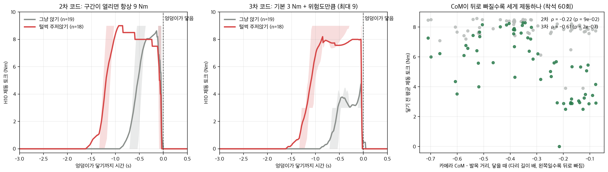

# 보조 알고리즘 1차 → 2차 → 3차

H10 착석 보조 알고리즘이 실측을 거치며 어떻게 바뀌었는지 정리합니다. 코드는 아래 폴더에 있습니다.

| 버전 | 코드 | 장비에서 돌렸나 |
|---|---|---|
| 1차 | `firmware/sit_assist.c` 이전 버전 (Python `sit_assist.py`와 같은 계산) | 1차 실측 |
| 2차 | `firmware/device_2nd_test/` | 11/9 2차 실측 |
| 3차 | `firmware/device_3rd_test/` | 아직. 기록 재생으로만 확인 |

---

## 1. 1차: 평소보다 빠를 때만 제동

**생각:** 평소 착석 30회로 허벅지 각도마다 평소 속도를 저장하고, 지금 속도가 평소보다 많이 빠르면(z > 3.5) 그만큼 제동합니다. 낮은 의자이거나 상체를 덜 숙이면 1.5배.

**1차 실측에서 나온 문제**

| 문제 | 원인 |
|---|---|
| ① 닿기 직전에 다시 빨라짐 | 속도가 평소보다 빨라진 '뒤에야' 제동해서 늦었습니다. 털썩 주저앉기는 반쯤 천천히 내려가다 마지막에만 떨어집니다. 기록 재생에서 털썩 주저앉기 11회 중 **닿기 전에 제동한 경우 0회** |
| ② 앉기 전부터 보조가 들어감 | 서 있음 → 내려감 판단이 작은 움직임에도 넘어갔습니다 |
| ③ 서 있을 때도 보조가 켜짐 | 같은 원인 |
| ④ 착석 근처에서 제동이 여러 번 다시 걸림 | 멈칫할 때마다 제동이 끊겼다 다시 켜졌습니다 |

## 2. 2차: 구간 제동 (1차 문제를 피하는 데 집중)

1차의 문제를 **단순하게 막는 쪽**으로 바꿨습니다.

| 1차 문제 | 2차에서 바꾼 것 |
|---|---|
| ① 늦은 제동 | 속도를 기다리지 않고, 구간이 열리면 **바로 9 Nm** |
| ② · ③ 앉기 전 · 서 있을 때 켜짐 | **허벅지 25°~70°**에서 **두 허벅지가 함께 10°/s 넘게** 굽혀질 때만 구간을 엶. 구간 밖 토크 0 |
| ④ 반복 제동 | **한 번 내려갈 때 한 번만.** 70° · 착석 · 0.06초 멈춤이면 끝 |

**결과 (11/9 2차 실측):** 닿기 직전 하강 속도가 45 cm 0.71 → 0.53 m/s(−25%), 30 cm 0.61 → 0.36 m/s(−40%), 둘 다 p < 0.001. **제동이 하강 속도를 실제로 줄인다**는 것은 확인했습니다.

### 2차의 한계

| 한계 | 왜 문제인가 |
|---|---|
| ① 누구에게나, 어떻게 앉든 **항상 9 Nm** | 평소처럼 잘 앉아도 털썩 주저앉아도 똑같이 제동합니다. 연구에서 찾은 개인 기준 · 위험 신호가 쓰이지 않습니다. 코드 안에 속도 점수 · 낮은 의자 · 상체 덜 숙임 계산은 있었지만, 기본 9 Nm = 상한 9 Nm라 결과가 언제나 9 Nm였습니다 |
| ② 제동 세기가 CoM과 관계없음 | 기록 재생에서 제동 토크와 카메라 CoM의 관계 ρ = −0.22 (p = 0.09). 위험한 착석을 골라 세게 거는 보조가 아닙니다 |
| ③ 낮은 의자에서 마지막 구간을 놓침 | 구간이 70°에서 끝나는데, 30 cm 의자는 평균 76.3°에서 닿습니다. 가장 깊은 마지막 몇 도는 제동이 없습니다 |
| ④ 평소 착석에도 강한 개입 | 매번 9 Nm라, 평소 착석에서 불편하거나 근력을 덜 쓰게 될 수 있습니다 |

## 3. 3차: 구간은 그대로, 세기는 연구 결과로

2차 실측에서 문제없이 돌아간 **구간 제동은 그대로** 두고, 구간 안의 **세기만** 바꿨습니다.

```
토크 = 기본 3 Nm + 6 Nm × 위험도      (3 ~ 9 Nm, 상한 9 Nm 그대로)
위험도 = max(① 속도, ② 추정 CoM, ③ 낮은 의자)     (0 ~ 1)
```

| 2차 한계 | 3차에서 바꾼 것 | 연구 근거 |
|---|---|---|
| ① 항상 9 Nm | 평소 착석은 **3 Nm**, 위험할수록 9 Nm까지 | 개인 기준(평소 30회) |
| ② CoM과 무관 | **① 속도:** 평소보다 빠른 정도(z 1.0 → 3.5에서 위험도 0 → 1) | 허벅지 속도 ↔ 카메라 CoM ρ −0.60 |
| | **② 추정 CoM:** H10 각도(허벅지 + 상체 숙임, 정강이 17° 가정)와 Winter 분절 무게 비율로 CoM을 계산하고, 같은 허벅지 각도에서 평소 상체 숙임일 때보다 얼마나 뒤인지(다리 길이 1% → 3%에서 위험도 0 → 1) | H10 추정 CoM ↔ 카메라 CoM r 0.74. 상체를 덜 숙이는 건 착석 약 1초 전에 나타남 |
| ③ 낮은 의자 마지막 구간 | **③ 낮은 의자:** 평소 최대 깊이 69.4°를 넘으면 위험도 1, 구간을 착석(최대 95°)까지 연장 | 30 cm에서 10.7° 더 깊이 앉음 |
| ④ 평소에도 강한 개입 | 위와 같음 (평소 3 Nm) | |

함수 이름과 인자는 2차와 같아서, 세 파일만 바꿔 넣으면 됩니다. 실측 순서는 `device_3rd_test/README.md`에 있습니다.

---

## 4. 기록 재생(시뮬레이션)은 어떻게 했나

**영상이 알고리즘에 들어가는 것은 아닙니다.** 알고리즘에는 H10 기록만 들어가고, 영상은 '이 착석이 얼마나 위험했나'를 매기는 **정답지**로만 씁니다.

### ① 미리 만들어 둔 데이터 (11/7)
1. H10을 입고 옆에서 카메라로 전신을 찍으면서 앉았습니다. 첫 번째 피험자 45 cm(그냥 9 · 털썩 8), 30 cm(그냥 10 · 털썩 10), 두 번째 피험자 30 cm(그냥 11 · 털썩 12), **모두 60회**입니다.
2. 영상의 매 장면에서 포즈 추정(MediaPipe)으로 관절 위치를 찾고, Winter(2009) 분절 무게 비율로 평균해 **CoM**을 구했습니다. 엉덩이가 의자에 닿는 순간 CoM이 발목보다 얼마나 뒤에 있는지(다리 길이 배)를 착석마다 하나씩 얻었습니다.
3. 카메라와 H10의 허벅지 각도 곡선을 맞춰 **시간을 동기화**했습니다(두 장비의 허벅지 각도 r = 0.99). 그래서 각 착석이 H10 기록의 몇 초에 닿았는지 압니다.
4. 이 표가 `results/video/pooled_sits.csv`입니다. 착석마다 [H10 기록의 닿은 시각, 그냥/털썩, 카메라 CoM]이 있습니다.

### ② 재생 (`firmware/replay_3rd_test.py`)
1. 2차 · 3차 **C 코드를 그대로** 컴파일합니다(장비에 들어가는 코드와 같은 파일).
2. H10 기록(1 kHz)을 10개씩 평균해 100 Hz로 만들고, **처음부터 끝까지 한 샘플씩** C 코드에 넣습니다. 실제 장비에서 돌아가는 것과 같은 순서입니다. 서 있음 판단, 구간 열림, 토크 계산이 모두 이 안에서 일어납니다.
3. 착석마다 엉덩이가 닿기 3초 전부터 닿을 때까지 C 코드가 낸 토크를 잘라 봅니다.
4. 그 토크를 영상에서 구한 카메라 CoM과 비교합니다. CoM이 뒤로 빠진(위험한) 착석일수록 토크가 크면, 위험한 착석을 골라 제동한다는 뜻입니다.

```bash
python firmware/replay_3rd_test.py --fig firmware/device_3rd_test/fig_replay.png
```

### ③ 결과



- **왼쪽 (2차):** 그냥 앉기(회색)도 털썩 주저앉기(빨강)도 8~9 Nm까지 올라갑니다.
- **가운데 (3차):** 그냥 앉기는 3~4 Nm, 털썩 주저앉기는 닿기 약 1초 전부터 8 Nm 근처입니다.
- **오른쪽:** 가로축이 카메라 CoM(왼쪽일수록 뒤로 빠짐), 세로축이 평균 토크입니다. 2차(회색)는 거의 평평하고(ρ −0.22, p 0.09), 3차(초록)는 CoM이 뒤로 빠질수록 세집니다(**ρ −0.61, p < 0.001**).

| 닿기 전 평균 토크 | 그냥 앉기 | 털썩 주저앉기 |
|---|---|---|
| 2차 · 첫 번째 피험자 45 cm | 7.2 Nm | 8.4 Nm |
| 3차 · 첫 번째 피험자 45 cm | 3.2 Nm | 7.0 Nm |
| 3차 · 첫 번째 피험자 30 cm | 3.9 Nm | 7.9 Nm |
| 3차 · 두 번째 피험자 30 cm | 4.9 Nm | 5.9 Nm |

### ④ 이 재생으로 말할 수 있는 것과 없는 것
- **있는 것:** 같은 H10 신호를 넣었을 때 3차 코드가 위험한 착석에 더 세게, 더 일찍 제동한다.
- **없는 것:** 제동 때문에 실제로 몸이 어떻게 움직였을지. 기록은 보조 없이 앉은 것이라, 토크를 걸었을 때 하강 속도가 얼마나 줄지는 재생으로 알 수 없습니다. 이건 3차 실측에서 영상으로 하강 속도를 재야 합니다.
- 기준값은 첫 번째 피험자 것이라, 두 번째 피험자에서는 차이가 작습니다. 실측 전 착용자 본인 기준을 만들어야 합니다.
- 위험도 문턱값을 같은 60회를 보며 정했으므로, 새 착석으로 다시 확인해야 합니다.
